# Drama Studio — 纯本地 AI 短剧生产流水线

> **100% 本地生成**：剧本推理走本地 Ollama，画面/视频走本地 ComfyUI，配音默认走 edge-tts 免费音色引擎、可在音色源里一键切到本机自建 TTS 服务 —— **全流程零云端 API、零按次付费、数据不出本机**。
> 为 **8GB 显存笔记本 GPU（RTX 4070 Laptop）** 量身调优：显存感知选档 + 串行调度 + 显存卸载，高端模型也能跑。
> 所有底模档位、参考链路模型、LoRA 目录、加速方法与服务地址都能在界面左侧 **「⚙️ 配置」后台面板**里改，不用动代码。

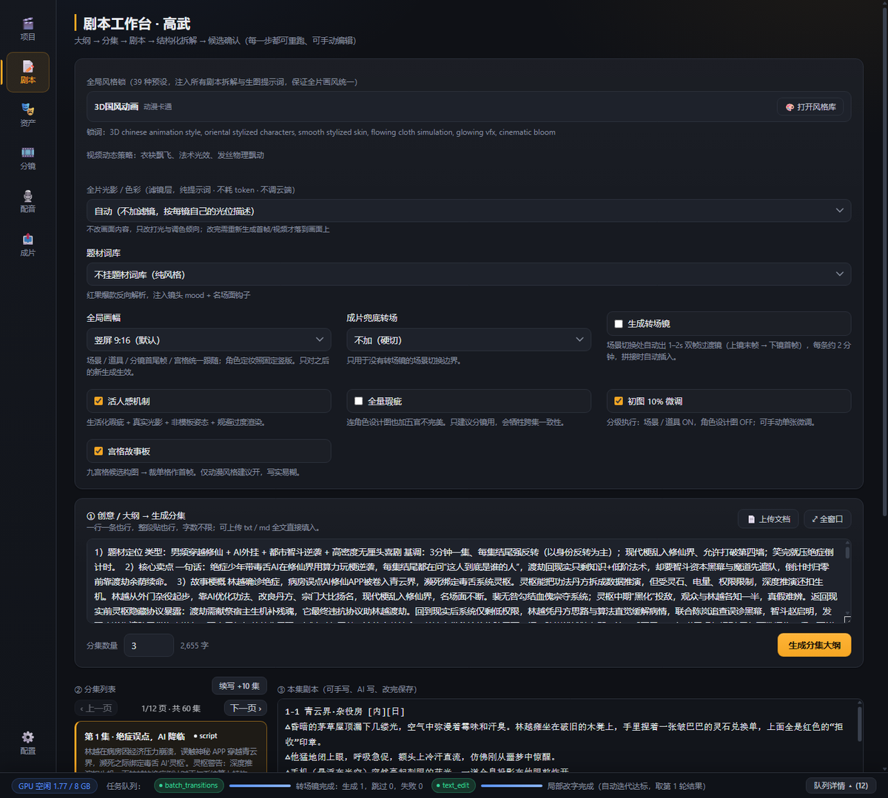

## 标签 / Tags

`local-first` `ai-video` `short-drama` `comfyui` `ollama` `fastapi` `sdxl` `wan21` `infinitetalk` `ipadapter` `image-to-video` `storyboard` `film-production` `low-vram` `rtx-4070` `prompt-engineering` `vertical-drama` `face-consistency` `scene-anchoring` `motion-control`

---

## 用途

把**一句话创意**变成**成片 MP4** 的单机全流程工具：

```
一句话创意 → 分集大纲 → 标准格式剧本 → 导演级分镜拆解 → 角色定妆照（三视图）
→ 场景/道具资产 → 首帧/尾帧 → AI 视频（i2v） → 口型对齐说话镜头 → 配音混音 → 字幕烧录 → 成片
```

适用于：竖屏短剧创作、AI 叙事视频实验、低成本动画/写实短剧生产、ComfyUI 工作流工程化实践。
支持导出 **剪映草稿 JSON** 与 **FCPXML**（Premiere / DaVinci / FCPX 可导入），AI 生成 + 人工精剪两开花。

## 核心功能

按生产链路分为六大类：**创作 → 词库 → 资产 → 视频 → 成片 → 工程**。

### 一、剧本与分镜创作

| 模块 | 功能 | 技术 |
|---|---|---|
| 剧本工坊 | 一句话 → 高概念 → 分集大纲 → 标准剧本（场号/△动作行/紧凑对白/音效字幕）；**集数硬保证**（分批生成+自动补齐，最高 60 集，LLM 偷懒也凑满）；**续写分集**（保留已有集接写后 10 集，逐集自动 AI 写剧本，单集失败可单独重试）；分集列表分页浏览；**大纲输入支持多行文本 + 全窗口弹层编辑（不设字数上限）+ 上传本地 txt/md 全文自动填入**（UTF-8 优先、乱码回落 GB18030，兼容国内 GBK 小说文本） | 本地 Ollama (qwen) |
| 导演拆解 | **大师级导演/编剧分镜**：12 条专业覆盖语法（定场镜/正反打+过肩/180° 轴线锁视线/反应镜/插入镜/cut-on-action）+ **竖屏留存波形节奏编排**（hook 开场钩子→压迫→激化→反转峰值→集尾 cliffhanger 五段情绪循环，拍点张力词直落提示词）+ 运镜多样性启发式兜底；角色**国家/地区形象**槽位（11 预设） | 规则解析 + LLM |

### 二、提示词词库引擎（双层正交叠加）

| 词库 | 功能 | 实现 |
|---|---|---|
| 风格词库 | 26 个风格包：动漫 Danbooru 词系/仙侠/国风水墨/cyberpunk/VFX 特效四要素，负面链防风格串味 | style_vocab.py |
| 题材词库 | 14 个红果爆款题材包反向解析：战神/赘婿/霸总/宫斗…，setting/wardrobe/mood/hooks/negative 五类，光比公式+名场面钩子词 | style_vocab.py |
| 打斗词库 | 动作镜自动识别：打击=发力→接触→受击动量链编排词、追逐=动量+变向，负面挡假打/无重力/血腥 | action_vocab.py |
| 特效词库 | 14 类特效镜自动识别：慢镜/时间静止/金光/气浪/爆炸/闪电/暴雨/雾/花瓣/光柱/狂风/碎裂/水花/闪回，特效必写环境反应防贴纸感，每镜封顶 2 种 | vfx_vocab.py |
| 模型方言库 | 按下游模型组词：Qwen-Image（自然语言长描述/文字渲染/版式跟随）、MiniMax H3（I2V 运动+运镜+氛围音，cfg=1 无负面故全正向）、wan/infinitalk 备用档 | model_vocab.py |
| 自强化词库 | 种子词块 + kept/failed 权重学习：产物提示词反查命中计数，kept≥2 转正、failed≥3 且 kept=0 拉黑；`POST /api/prompt-bank/harvest` 从现存成功产物提炼（过滤画质尾巴/剧情UI词/跨族方言/光照词，视频库只收运镜-物理-氛围类） | prompt_bank.py |

> 双层叠加规则：画风层 × 题材层正交组合；角色三视图只取风格锚，防特效/题材词污染设定图。模型方言层（组装期按下游模型组词 + 生成期兜底）详见下方方法论。

### 三、资产生成与一致性

| 模块 | 功能 | 技术 |
|---|---|---|
| 角色资产 | **人物设计图**版式（参照 RunningHub 概念设定稿，不再三视图/四视图）：中心全身立绘 + 左侧服装分层（上衣/内衫/裤/鞋各带标注）+ 右上同一张脸的多种情绪头 + 右侧材质特写/放大裁切 + 随身物件 + 手绘箭头与手写标注 + 米黄纸纹底；3:4 竖版 768x1024，默认 **Qwen-Image 2.1 整张一次成型**（中文标注、表情头、材质格唯一能出的底模），SDXL(RealVisXL) 作兼容通道；版式词压进单个提示词块（约 90 词，含 6 个人物调节槽位各 ≤6 词） | Qwen-Image 2.1 int8 / SDXL |
| 一致性锁 | IPAdapter 锁脸（单人/双人链式双 IPA）+ **锁脸治理**（meta 感知判定不再误拒裁脸图、特写/像素面积择优喂参考、角色级默认脸锁钉死参考版本） | ComfyUI |
| 场景锚定 | 场景锚定图**三级回退**（手动锚→iso 布局图→最新场景图，一键批量补齐）+ 末帧接力，跨镜背景漂移压制 | ComfyUI |
| 场景资产（**场景设计图**，**#100**） | 从"一张效果图"升级为**环境设计板**（对齐 RunningHub 无限画布 RHTV）：上半大幅主 establishing view 居中 + 左下第二角度 + 中部三块材质/符文/陈设特写 + 右侧手绘俯视平面草图（线稿）+ 箭头连接 + 手写标注 + 底部色卡 + 米黄纸纹底、无人物留白。版式常量 `SCENE_DESIGN_SPEC` 由 `assemble_scene_prompt(design_sheet=True)` 插在**主体词之后、风格锁之前**；`text_content` 写进牌匾/招牌。**防污染**：`POSITIVE_SUFFIX` 去掉 `clean plain background`（会顶掉纸纹底）、`auto_scene_anchors` 的 iso 布局图强制 `design_sheet=False`、`regenerate` 的 iso 分支先 `strip_design_spec()`、`shot_service._scene_anchor` 自动回退跳过设计图（防箭头/标注被当环境参考画进首帧） | Qwen-Image 2.1 |
| 道具资产（**道具设计图**，**#100**） | 中心 3/4 主图 + 正/侧/俯/背多视图 + 材质纹样特写 + 尺寸标注线（300 / 507.68 …）+ 中文手写标注 + 底部色卡 + 米黄纸底，一张板子交代体积与做法。白底单品版式（`PROP_SPEC`）与"背景虚化融进环境"只在 `design_sheet=False` 时保留；**带文字道具仍优先走 MOSS / Ideogram 文字档**（牌面文字准 > 设定板），`text_content` 同时写"牌面 + 面板旁标注"两处。道具三分类不变（核心叙事/角色连接/环境氛围——氛围道具并入场景不独立生成） | Qwen-Image 2.1 |

### 四、视频生成

| 模块 | 功能 | 技术 |
|---|---|---|
| 首帧/宫格 | 双帧 i2v 首帧（IPA 锁脸）/ 尾帧 / 九宫格候选构图（**仅动漫风格，写实禁用防糊**，裁单格作首帧） | ComfyUI |
| i2v 视频 | Wan2.1 双帧 i2v / 单帧续写 / 镜内延长（ffmpeg 无损拼接）；**六槽位身体部位级动作控制**（posture/gesture/expression/gaze/intensity/secondary）+ 运镜稳定性约束（no jitter/no morphing/feet not slide/单主力运镜） | Wan2.1 480P fp8 |
| 口型对齐 | 台词 → 逐句 TTS → 音频驱动说话视频，口型全程跟音频 | InfiniteTalk |
| 镜间转场 | **场景锁定默认开**（锚图 img2img 压同场景背景漂移）+ 同场景**末帧接力**（跨场景守卫：边界不接力改走场景锚图独立生成）+ **转场词双端注入**（match_cut/whip_pan/object_pass/light_flash）+ 可选**双帧转场镜**（场景边界上镜末帧→下镜首帧 i2v，幂等批量任务；**参考生视频档可切 H3 turbo（24fps 带原生音频）或 Wan2.2 首尾帧 Q4（16fps 双模型 4 步，9G 更省显存）**）+ 成片**三级插入**（转场镜 → 黑场/白闪兜底段 → 硬切） | ComfyUI + ffmpeg |

### 五、配音与成片导出

| 模块 | 功能 | 技术 |
|---|---|---|
| 配音成片 | 音色跨集锁定 + 角色性别强匹配 + 语气层（11 种情绪映射语速音调）+ 混音 + SRT 烧录（NVENC 硬编）；音色清单本地可配（`data/voice_sources.yaml`），可按条切本地 TTS 服务；配套 1248 款本地参考音频（积木音色库）可搜索试听并一键加入 | edge-tts（默认）/ 本地 HTTP TTS（GPT-SoVITS · OpenAI 兼容）+ ffmpeg |
| 批量编排 | 一键全流程（首帧→视频→配音→成片）/ 断点续跑 / 向后重链 / 断链即停 | FastAPI 编排 |
| 外部导出 | **剪映草稿 JSON** 与 **FCPXML**（Premiere / DaVinci / FCPX 可导入），AI 生成 + 人工精剪两开花 | pipeline_service |

### 六、工程与可视化

| 模块 | 功能 | 技术 |
|---|---|---|
| 任务系统 | 串行队列 + SSE 实时进度 + 页面重开任务回放（重连全量对账 + 15s 兜底轮询，防断线旧快照）+ 暂停/取消/继续；三态区分 `failed`（真实报错）与 `interrupted`（服务重启/离线/ComfyUI 不可达，参数保留可继续）；显存感知选档（8GB 友好） | FastAPI + SSE |
| 可视化 | 分镜时间轴（镜头卡：参考图/提示词/参数全溯源）、参考溯源窗口（可换角色/场景参考）、提示词模板编辑器、全局画幅设置（16:9/21:9/4:3/9:16/3:4/1:1）；生成设置区为两列自适应网格（标题→控件→说明三段式，开关做状态卡片，开启高亮） | React + Vite |
| 图片增强 | 单张超分放大（upscale 工作流）、初图 10% 自动微调 | ComfyUI |
| RHTV 可视化控件 | 对齐 RunningHub 无限画布，把"靠提示词碰运气"的地方做成按钮：**导演台**（镜头卡 🎥 → 13 条运镜预设 + 7 组按钮：景别 / 机位 / 运镜 / 速度 / 焦段 / 焦点 / 转场，每个按钮带一行"画面后果"副行；点一下即写字段并**零 LLM 整集重算提示词**，机位词（low-angle / over-the-shoulder / dutch angle…）进首帧与关键帧，位移型运镜或人物轨迹自动挂尾帧）；**风格库**（**列表 39 种 / 收录 57 种，8 分类**——动漫卡通 14 / 国风东方 5 / 摄影写实 7 / 插画数字 13 / 复古未来 7 / 潮玩3D 6 / 暗黑废土 2 / 设计工程 3，其中**只显示 AI 短剧 / AI 漫剧用得上的 39 种**（#103：像素/体素/纸张肌理/设计示意类共 18 种保留文字说明与缩略图、暂不入列）（**#100**，参照 liblib.art 生图风格模型库扩充：日系厚涂 / 国漫新番 / 90 年代赛璐璐 / 彩铅 / 炭笔 / 马克笔 / 孔版印刷 / 木刻版画 / 剪纸 / 不透明水彩 / 盲盒潮玩 / 黏土定格 / 毛绒玩偶 / 体素 / 等距2.5D / 硬表面机甲 / Y2K 千禧 / 蒸汽波 / 暗黑哥特 / 废土末世 / 工程蓝图 / 科技线框 / 玻璃拟态霓虹）+ 搜索 + 缩略卡片网格，分类由 `/api/director/meta` 动态下发、前端零硬编码，点卡片整体切换项目风格锁并重组装全部资产提示词；每张卡片配**示例缩略图**（#103：本地 Qwen-Image 批量生成，同一主体同一构图、只换风格锁，`GET /api/style-samples/{key}.jpg` 供图；**#104** 把风格名压在缩略图底部渐变条上、选中项右上角挂琥珀"当前"角标）+ 剧本页风格锁改为**只读信息条 +「🎨 打开风格库」单入口**（**#104**：分组下拉框已删，切换只在弹窗内做，避免两处入口口径不一）；**人物调节**（面部 / 表情基调 / 发型 / 妆容 / 体型 / 姿态 / 服装质感 / 随身饰物 8 组 47 chips，点选替换槽位、再点取消，直接进设计图提示词） | `app/director.py` · `GET /api/director/meta` · `POST /api/shots/{id}/director-apply` |
| 图上的文字（**局部改字**，角色/场景/道具三类 · **#100**） | 令牌铭文 / 符箓榜文 / 契约账册 / 票券告示这类"画面主体就是文字"的道具，以及**角色设计图上的手写标注、场景设计图里的牌匾 / 门额 / 招牌**，一律先用本地底模生成整张图（Qwen-Image 实测五字全对），**字不对时在原图上只重画文字那一块**，而不是整图重渲：资产卡「📝 改字」（`image_ids` 非空即出现，三类资产都有）→ 在图上拖框圈住文字区 → 填要写的字 → 提交。实现是 `VAEEncode(原图)` → `SetLatentNoiseMask(mask)` → `KSampler(denoise 0.88)`：框外 latent 原样透传，所以纸纹 / 折痕 / 朱印 / 边框 / 水墨 / 光影一点不动，只换字（羽化 mask 防接缝）。零 token、零云端。**默认框按资产类型取**（后端 `DEFAULT_BOX_BY_KIND` / 前端 `TEXT_BOX_BY_ETYPE`，前后端数值一致）：道具 `(0.335, 0.195, 0.30, 0.545)` 对准中上竖排大字段、场景 `(0.26, 0.22, 0.48, 0.26)` 对准门额 / 牌匾横块、角色 `(0.04, 0.86, 0.92, 0.11)` 对准底部标注通栏；可拖框微调、可调重绘强度 0.6–0.98。提示词按 `surface_kind` 换载体语境（物件表面随弧度 / 门额墙面随透视 / 设计图纸手写标注），`lang` 由 `text_prop.detect_lang` 自动判中英，英文改走 "clean printed capital letters, correct spelling, evenly spaced on one line"。产物沿用源图 kind 落库，直接追加到对应卡片版本历史。**注**：此前"带文字道具整图走 GPT-Image 2.5"的通道已彻底移除（配置面板、settings 段、云端 HTTP 调用全删）——该模型是闭源 API、没有可下载的本地权重，整图生成还会换构图/换纸纹，不满足"只改字" | `app/text_prop.py` · `app/services/text_edit_service.py` · `workflows/prop_text_inpaint.json` · `POST /api/assets/{aid}/text-edit` |
| 图上的文字 · **自动迭代判字**（**#101**） | 「📝 改字」默认开自动迭代：每轮画完用**本地 OCR**（RapidOCR / PP-OCRv4 ONNX，CPU 即可跑，零 token、零显存占用，不与 ComfyUI 抢 8G 卡）读一遍框内的字，与目标逐字比对；不达标就按生成情况**重新框选再画**，直到读对或用完轮次（默认 3 轮，可选 1–5）。判定口径：中文短句（≤4 字）要求全对、长句命中 ≥90%，英文单词 ≥85%，另看 OCR 置信度；尺寸标注（300 / 507.68 / 620×840）不算文字内容，判定前剔除。缩框**看情况而不是机械等比缩小**：目标字只占框的一部分（<55%）时收到"目标字最集中"的那一块、面积压到上一轮 85% 以内；目标字本来就占满框（竖排五字顶到框边）时**不缩**——实测缩到 26%×46% 会把第五个字切掉、出「券」+ 叠笔残影。短边到 56px 即停（再小模型写不出清晰字）。每轮换 seed、重绘强度 +0.05（上限 0.95）、第 2 轮起追加"蒙版内原有字形必须完全擦除，不得保留旧笔画或残影"，并且**每轮都回到原始图重画**（不在上一轮产物上再叠一遍，否则错字残笔会一层层堆着，越迭越糊）。能定位到"具体是第几个字写错了"时（整串 ≥3 字、OCR 读数与目标逐位对齐），**把框收窄到那一个字**、提示词也只写这一个字——整段重写经常"改对一个、又写坏另一个"。**落库取最好的一轮而不是最后一轮**（按命中率 + 置信度挑），中间轮文件物理删除；连续两轮读不出字、或命中率不再提升会自动停，不白烧时间。弹窗里可开/关、选轮次，任务进度与结果里能看到每轮命中率、框尺寸与 OCR 读数。**已知盲区**：旧字的下半截若落在框底之外，会以一小块"残笔"留在图上（OCR 不把它算作字，判定看不出来）——拖框时把下缘多留 5% 即可；发光红字 / 极小标注 OCR 读不出，会在两轮后判"读不出字"停止 | `app/services/text_ocr.py` · `app/services/text_judge.py` · `app/services/text_edit_service.py` · `POST /api/assets/{aid}/text-edit` |
| 带文字道具 · 双本地文字模型（**#99**） | 带文字道具按**要写的字**自动分流，两条都是本地权重、零云端：**中文 → MOSS-Image SFT INT8 + 8 步 DMD 蒸馏**（`img_moss_text`，768×1344 约 36–40 秒；毛笔竖排五字逐字准，皱纸 / 朱印 / 水墨 / 边缘光保真）；**英文 → Ideogram 4 fp8 双模型 + Qwen3-VL 8B 编码器**（`img_ideogram4_text`，`Ideogram4Scheduler` 20 步、`CFGOverride` 3.0（0.7–1.0）、`DualModelGuider` cfg 7、mu 0.0 / std 1.5，约 85 秒；`QING YUN SECT TOKEN` 逐字母准确）。**Ideogram 4 必须吃结构化 JSON caption**：自然语言 prompt 一律回灰底「Image blocked by safety filter」（连 "a red apple on a wooden table" 都被拦，int8 与 bf16 编码器均复现），换成 caption 结构立刻正常 —— 英文档由 `text_caption.build_caption()` 用槽位现拼 caption；两条硬经验：obj 描述里必须剔掉要写的同一串字（否则模型把文字画两遍、重叠错位），文字块要给"宽块 + 每词一行"（窄高块会把 `SECT` 压成 `SEC` 并混入中文伪字）。中文档反向强调"画面中只出现这几个字"，压掉周边装饰小字。分流位置 `asset_service.generate_asset`：`role=prop` + 有 `surface_text` + 未显式指定 `model_key` → `text_prop.detect_lang` 判语言 → 点名 `img_moss_text` / `img_ideogram4_text`（两档 `auto: false`，不会被自动选档误选）；文字档画幅强制 16 倍数（`Ideogram4Scheduler` / `EmptyFlux2LatentImage` 的硬约束）。 | `app/text_prop.py` · `app/text_caption.py` · `app/services/asset_service.py` · `workflows/prop_text_moss.json` · `workflows/prop_text_ideogram4.json` · `data/models.yaml` |
| 光影 / 色彩滤镜预设 | 对齐 RHTV 图片/视频节点底部的"滤镜条"：18 条预设（**光线 12**：黄金时刻 / 蓝调时刻 / 阴天柔光 / 烛火暖光 / 月光冷调 / 霓虹夜 / 正午硬光 / 柔光棚拍 / 逆光剪影 / 底光诡异 / 窗棂光柱 / 薄雾漫射；**色彩 6**：青橙电影调 / 漂白高对比 / 胶片低饱和 / 国潮高饱和 / 黑白水墨 / 奶油柔粉），点选即把成套光影词塞进首帧提示词，一串镜头观感自动统一。**三级作用域**：单镜（导演台）> 全片（剧本页「全片光影 / 色彩」下拉）> 空（各镜自己的光位描述）。**纯提示词层，零 token、零云端调用**：写入即本地重算全项目提示词（不重跑 LLM），无后期 LUT、无额外模型；只进图片侧（首帧 / 尾帧 / 关键帧），不进 I2V 视频提示词（避免逐帧重新想象颜色导致闪烁）。分镜短模板只给 4 词短版词组，防止挤掉内容项 | `app/light_grades.py` · `GET /api/director/meta` · `POST /api/shots/{id}/director-apply` · `POST /api/projects/{pid}/light-grade` |
| 后台配置 | 顶部四个选项卡管全部参数：**模型档位**（6 个模型档：生图 / 生视频主链路 / 写实参考生图 / 动漫参考生图 / **参考生视频（H3 turbo / Wan2.2 首尾帧 Q4 两档可选）** / 口型）、**LoRA 与加速**（LoRA 根目录、4 步蒸馏 LoRA 开关、注意力后端 PyTorch / SageAttention、WAN 采样步数）、**服务与路径**（ComfyUI / Ollama 地址与安装目录、extra_model_paths）、**音色源（本地）**（全局切 edge-tts / 本地 HTTP 服务、协议与超时、音色清单增删与逐条试听、连接探测，以及 **本地音色库：1248 款参考音频搜索/筛选/分页、原声试听、单条或整页批量加入清单**）。模型档即时生效；安装目录/extra_paths/注意力重启 ComfyUI（守护进程现读配置）；服务地址重启后端。保存时校验档位与 family，写错当场拒绝。**无任何云端出图 key 配置**——图片与语音链路全本地 | settings.py + voice_sources.py + voice_library.py + `/api/settings` + `/api/voice-sources` + `/api/voice-library` |

## 方法论（内建于代码，非文档）

系统不是"提示词生成器"，而是把一套短剧生产方法论**源码级落地**：

- **第三章 · 高概念公式**：熟悉设定 + 颠覆性反差 = 高概念；三幕剧拆集，每集解决一个具体矛盾、结尾设强钩子。**集数硬保证**：小模型对"共 N 集"服从度差（实测 4B 模型要 3 集只给 2 集），大纲按 6 集/批循环补齐；续写分集与重建式生成分离，重建清空重走、续写只追加。
- **第一章 · 影视标准格式**：场号仅在场景/时间切换时新增（严禁每节拍开新场）、动作行只写可视化内容、心理描写强制转动作。
- **导演覆盖语法 + 留存波形**：切镜从"八原则"升级为 12 条专业覆盖语法（正反打锁 180° 轴线、反应镜给戏眼、插入镜给证据、cut on action），节奏按竖屏留存波形编排（0-3s 钩子截停→压迫→激化→反转峰值→集尾 cliffhanger 留扣），拍点张力词注入提示词；LLM 偷懒全"固定慢"时由启发式重排兜底。
- **双层提示词词库**：风格词库（画风层：动漫 Danbooru 词系配"禁摄影词"负面、仙侠三段式、VFX 特效=颜色+形状+粒子+动势）× 题材词库（题材层：红果爆款反向解析的光比公式——甜宠 1-2:1/悬疑 6:1/权谋伦勃朗 10:1——与名场面钩子词），负面链自动防风格/题材串味。
- **运动动作控制**：六槽位身体部位级公式（谁+身体部位+做什么+朝向），I2V 遵循 Wan 官方运动公式——图定义实体、文只管运动，稳定性词必备。
- **第二章 · 九段式角色公式**：identity → appearance → face → hair → clothing → makeup → accessories → expression → pose，抽象形容词一律转为可视觉化符号（"帅气"→"嘴角微翘、下颌线利落"）。
- **道具三分类**：核心叙事 / 角色连接 / 环境氛围——氛围道具不独立生成并入场景，出现 ≥2 次的引用道具才自动晋升。
- **活人感五机制**：质感瑕疵（皮肤毛孔/发丝凌乱/布料褶皱）+ 物理光源（单一主光源+色温混合）+ 非模板姿态 + 10% 自动微调 + 防过度渲染负面词——专治"AI 塑料感"。三视图/定妆照自动切换身份安全版瑕疵，保跨集五官稳定。
- **风格锁按资产类型适配**：人像摄影词禁入道具/场景（避免"勺子→人脸"事故）；写实风格禁开宫格；空镜禁皮肤词。#84 强化：非角色资产按词块剔除人像词（眼睛/皮肤/发丝/服饰），人形排除走负向词链（正向 "no people" 对 SDXL 无效反而引人物）。
- **风格→底模自动映射**：photo→RealVisXL（道具/场景自动档走 Flux2-Klein，实物理解更强）/ **anime·paint→AnimagineXL 3.1**（真 SDXL 动漫底模 6.5G，AnythingXL 降为回退）/ **3D 族（Pixar·国风3D·游戏CG）→ Qwen-Image**（cel 3D 动画质感，13.5GB 靠 offload 在 8G 卡可跑）；改全局风格锁时存量实体提示词自动按新锁重算。这四类默认档在后台配置面板可逐项改。
- **全局底模切换（#87，2026-11-26 按显存分层修正）**：图片四角色（portrait/scene/prop/image_edit）默认走 **Qwen-Image**；视频默认档改成 **WAN2.1 480P**（fp8 + 4 步蒸馏 LoRA，实测 108s/条）——**MiniMax H3**（原生 UNetLoader 加载 fl2va pruned int8 + qwen3vl-32b nvfp4 文本编码器，24fps 原生音频，帧数对齐 17k+5 网格，BasicGuider cfg=1 无负面）用的是同一份 20GB int8 底模，8G 卡全靠分页，冷启首条 >40 分钟、长采样还可能把进程打死，因此 H3 降为**高质量档**（`vid_h3_turbo` / `vid_h3_int8`，显存 ≥16G 或单镜要 H3 音视频 latent 时在面板切回去即可）。辅助链路保持专用模型：分镜首帧/宫格/polish 锁 SDXL（IPA 锁脸依赖）、InfiniteTalk 口型镜不受全局默认影响；显式 model_key / prefer_tier 仍优先于任何默认（含面板配置）。
- **H3 turbo 提速档（#88）**：`vid_h3_turbo` = 同款 int8 底模（缓存复用）+ fl2v_turbo_8step LoRA（官方配 4 步采样），实测 2s 视频 30 分钟 → **4 分钟**（约 7.5 倍），画质略降；API `POST /shots/{id}/video` 传 `model_key: "vid_h3_turbo"` 即用。转场镜已迁到 H3 turbo 双帧（首=A末帧、尾=B首帧，`video_h3_turbo.json` 模板双 LoadImage 默认连接 first/last frame），wan22 双帧链路保留作回退。
- **成片拼接参数自适应（#89）**：wan 旧片（480x832@16fps）与 H3 新片（768x1344@24fps）混合时 concat demuxer 必坏——导出前逐段 ffprobe 探测分辨率/帧率，全段一致走 `-c copy` 无损快路，混合参数走 concat filter（scale/pad 对齐首段 + fps 归一）NVENC 重编码一次；批量视频/重链/一键全流程均支持 `model_key` 直通（不传走全局默认，混拼成片依然稳）。注：视频原生音频在成片合成中按既有设计丢弃，音轨统一由 TTS 配音重建（InfiniteTalk 口型片音频与 TTS 同源，同步不受影响）。
- **双模型提示词库 + 自强化（#90）**：拆解期生图按 **Qwen-Image 习惯**组词（自然语言长描述分层、文字渲染/版式跟随只给角色板与道具、场景图剔除文字指令防乱码）、生视频按 **MiniMax H3 习惯**组词（连续镜/运镜短语/动作分解/氛围音，全正向表述）。新增 `prompt_bank.json` 学习层：种子词块随代码内置，生成成功 kept+1、失败 failed+1，权重 = kept - 1.5*failed，实战提炼块优先于内置种子；`POST /api/prompt-bank/harvest` 扫描现存产物提炼词块（拦截画质尾巴/剧情 UI 词/跨族方言/光照词定性，视频库只收运镜-物理-氛围类，防"室内荧光灯"词块粘到"正午阳光"镜头）；视频侧同步剔除图像画质尾词与活人感锁（含否定句，H3 cfg=1 无效），180° 轴线提示改正向表述。API：`GET /api/prompt-bank`（权重视图）、`POST /api/prompt-bank/chunk`（手动增删）。
- **首帧底模按风格族对齐（#91）**：分镜首帧必须走 SDXL IPAdapter 锁脸通道，但底模此前只传 `style_family` 不点名——3D 国风在 SDXL 池内没有任何模型带 `3d` 标签，匹配落空后按档位平局取字典首个 = AnythingXL 动漫底模，于是 3D 项目首帧出成 2D 动漫人物；H3/Wan 是 I2V，直接继承首帧像素 → 视频角色与 Qwen-Image 生成的角色板"换人换画风"。现按风格族点名底模（3d/photo → RealVisXL 写实、anime/paint → AnimagineXL 3.1 动漫），写实负面锁（different face / plastic skin / distorted face）同步扩展到 3D；三视图裁脸区域从 0.5×0.85 收到 0.36×0.72，只取头肩特写（原区域会把右侧全身像一起裁进参考图，IPAdapter 学成混合版式、锁脸信号被稀释），角色可另存纯脸 `face_lock_path` 钉死版本。实测：首帧与角色板同一张脸，视频第 0 帧与首帧逐像素级同源，1.2s 处无换脸无脸崩。注：IPA 权重 0.8 会把参考图构图（半身）带进首帧，要按分镜 wide shot 出建议降到 0.7。
- **队列噪声治理与 interrupted 语义（#92）**：服务启动时的僵尸收尸旧逻辑把遗留 `running/pending` 一律标 `failed`——H3 单条 15–30 分钟，碰上改代码重启就凭空多一条红色失败（线上 45 条 failed 有 24 条是这个来源，队列里"失败进程一直出现"）。现改标 `interrupted`（琥珀「已中断」，参数原样保留，点「继续」按原参数重派；真实报错仍走 `failed`），并给了历史迁移脚本 `scripts/migrate_failed_to_interrupted.py`（默认预览、`--apply` 写库）。ComfyUI 不在时任务以 `httpx.ConnectError: All connection attempts failed` 收场，为此补了 `ComfyUI-Backend`（登录后 30s 拉起）与 `ComfyUI-Watchdog`（每 2 分钟探活 8188）两个计划任务，共用幂等脚本 `run_comfyui.vbs`（8188 已应答或已有 ComfyUI 进程即退出，防加载期重复拉起抢端口）。前端补 SSE 重连全量对账 + 15 秒兜底轮询，修掉断线后页面停在旧快照的"running 100%"假状态。
- **台词闪避 + 混音版下载 + 128k 试听代理 + 人声专补（#109，2026-11-28）**：四项按用户拍板落地。①**BGM 台词闪避（ducking）**：成片页「音频分轨」加勾选框与 3~24dB 强度，默认关、`PUT /api/audio-mix/duck` 落配置；实现在 `export_final` 里按**已排布的台词区间**生成 BGM 的 `volume` 表达式（每段进出 100ms 线性斜坡），**不用 `sidechaincompress`**——实测侧链方案在这条 17 路输入的 filtergraph 上把 BGM 在 4.06~7.13s、10.17~14.25s 压成 -91dB 数字静音（最小 2 路用例却不复现，属组合缺陷），改成纯增益表达式后静音段只剩片尾 fade（44.34~44.99s），台词段实测 -12.1dB（4.2s: -58.0 vs 关时 -45.9）、台词间隙恢复原音量。②**分轨混音版下载**：`export-status` 增 `mix_ready/mix_file`，新增 `GET /api/episodes/{eid}/final-mix-file`，成片预览区挂「⬇ 下载分轨混音版（未烧字幕）」。③**原码 + 128k 代理**：原码保留在 `media/`（合成仍用原码），新增 `tools/make_sfx_proxies.py` 增量转 `media_proxy/<id>.mp3`（实测约为原码 50%：106800 4.74→2.37MB、499668 1.73→0.86MB），`GET /api/sfx/{id}/audio` 默认返回代理、`?quality=orig` 取原码；临时文件必须保留 `.mp3` 后缀否则 ffmpeg 报 "Unable to choose an output format"。④**人声轨专补**：新增 `VOICE_KW`（40 词：人群/儿童/耳语/笑喊哭喘咳）与 `--preset voice`；同时修分轨判定——人声强词（talk/laugh/scream/whisper/applause…）排到 `amb` 之前，否则"人群底噪"全是 crowd 会被吞成环境音（当前 1713 条分布 bgm 318 / amb 1074 / voice 175 / sfx 146，voice 专补批次继续拉升）。
- **风格库缩略图叠风格名 + 剧本页风格锁降级为只读信息条（#104，2026-11-28）**：风格库卡片原来是"图在上、名字在下"，图铺满整块（`img` 层级高于文字层）后只剩一排认不出是谁的剧照，用户实测 39 张全部没有标识。改成**名字直接压在图上**：`.style-thumb-name` 绝对定位贴底、`z-index:2` 盖在 `img`（`z-index:0`）之上，底部 18px 黑色渐变遮罩保证任何亮度的图上都读得清，选中项右上角再挂一枚琥珀色"当前"角标；卡片下方只留 `分类 · family` 一行，不再重复名字。同时修掉一个隐藏的版式 bug：`.style-grid` 的 `auto` 行在"容器高度确定 + 内容超长"时会被压扁（实测行高 79.95px、卡片 80px，而缩略图本身 124px），名字条与底部信息行整条被 `overflow:hidden` 裁掉——这才是旧截图里"只有图、没有字"的真正原因；显式 `grid-auto-rows: max-content` 让行高按内容撑开、超出交给滚动区。剧本页的**风格锁**按用户决定收敛为单一入口：删掉分组 `<select>`（连带删掉无错误处理的 `savePreset`），改成**只读信息条** `.style-lock-bar`——左侧加粗风格名、右侧灰字分类、当前用的正好是隐藏风格时挂"暂不适用"、最右「🎨 打开风格库」按钮，整条可点/可回车；切换只在弹窗里做（弹窗 apply 有 try/catch 失败提示）。弹窗套用后通过 `onApplied(key)` 回写 `curPresetKey`，信息条**立即刷新**（只 mutate `project` 对象不会触发 React 重渲染，这是原实现的隐性 bug）。E2E（项目 2 / `guofeng_3d`）：39 张卡片名字全部非空且在卡内可见（`z=2`、`nameBottom ≤ cardBottom`），点「二次元动漫」后弹窗提示"已套用…6 个资产的提示词按新风格重组装"、信息条同步变「二次元动漫 / 动漫卡通」，切回「3D国风动画」后端落库 `guofeng_3d` 一致。
- **风格库配示例缩略图 + 只显示短剧漫剧用得上的（#103，2026-11-28）**：风格库原来是"色块渐变 + 风格名"的占位卡片，看不出风格长什么样。这次给**每个风格生成一张真实示例图**：用本地 ComfyUI + `char_portrait_qwen.json`（Qwen-Image 2.1 int8）出 768×1024，22 步，**同一段主体描述、同一构图**（"年轻剑客，破旧深蓝长袍，烛光古宅庭院，半身中景，脸部细节，电影构图"），前面只拼各风格的 `style_lock`——这样一眼能看出差异全在画风而不在内容；出图后压成 384×512 JPEG（约 30KB/张，57 张共约 1.7MB），存 `backend/data/style_samples/<key>.jpg`，由 `GET /api/style-samples/{key}.jpg` 供图（白名单校验 key，非注册风格一律 404，挡 `../` 穿越）。批量脚本 `backend/tools/gen_style_samples.py` 支持断点续跑（已有则跳过）、`--force` 全重出、`--only a,b` 单补失败项，失败不中断整批并打印可重跑的 `--only` 清单。单张实测 22–29 秒，57 张约半小时，全程本地、不耗 token、不调云端。**可见性**：用户要求"只保留 AI 短剧和 AI 漫剧用得上的风格，其余保留文字说明和缩略图、只是暂不在列表显示"。落地为 `STYLE_HIDDEN`（18 个）——判断口径是"能不能当一集几分钟、连拍十几镜、角色要复用的片子底色"：插画里的纸张/笔触肌理类 6（扁平矢量 / 炭笔 / 马克笔 / 孔版印刷 / 木刻版画 / 剪纸，每镜重画纹理、接戏对不上）、复古未来里的封面语汇 5（蒸汽波 / 像素 / 低多边形 / Y2K 光面，单张成立、连成戏散架）、潮玩 3D 里的物件类 4（盲盒 / 毛绒 / 体素 / 机甲，主体不承接人物表演）、设计工程 3（蓝图 / 线框 / 玻璃拟态，是工程示意语汇）——**保留 39 种**（动漫 14 + 国风 5 + 写实 7 + 插画 7 + 复古 2 赛博/蒸汽 + 潮玩 2 黏土定格/等距2.5D + 暗黑 2）。数据与缩略图 57 张全部保留，要放出来只从这个集合删 key，前端不用改。**三处出口同步收口**：`visible_presets()` 供 `style_library()` 与 `GET /api/style-presets`（默认 39，`?include_hidden=true` 拿全量 57 且每项带 `hidden` 标记）；`/api/director/meta` 的 item 新增 `thumb` 字段、`total` 改可见数并附 `hidden_total` / `hidden_note`；剧本页风格下拉只列可见项，**但项目当前若正用着隐藏风格，会把它额外挂出来并标"（暂不适用）"**（否则下拉空白、看不出当前风格）。前端卡片改成真图 ``（`object-fit: cover`、`object-position: center 26%` 横切保脸、懒加载、加载失败自动退回原渐变块），分类侧栏与标题计数全部跟可见集走。

- **参考生视频加 Wan 首尾帧档（#102，2026-11-28）**：面板「参考生视频 · 转场/首尾帧」原来只有 H3 turbo 一项——不是口味问题，而是转场链路 `generate_transition_clip` 的 overrides 写死了 `MiniMaxH3ImageToVideo.*` / `RandomNoise.*`，换模板必抛 `ComfyUIError`，所以面板和保存校验都只放 H3。这次把链路改成**按档分派**：`REF_VIDEO_MODELS = (vid_h3_turbo, vid_wan22_flf_q4)`，H3 走 `video_h3_turbo.json`（24fps、`MiniMaxH3ImageToVideo` 首帧+可选尾帧、原生音频 latent）；Wan 走 `i2v_first_last.json`（16fps、`WanFirstLastFrameToVideo` 强制双帧 + High/LowNoise 两个 `KSamplerAdvanced` 各段 4 步 + `positive_text/negative_text` 走 `_walk_to_text` 间接解析）。两者参数体系完全不同，所以**帧率、帧数网格、画幅、种子字段名、负向词全部按 family 分支给**：Wan 帧数取 `4n+1`（1–2s → 17/33 帧）、画幅取分镜桶并对齐 16、两个 sampler 共用一个 seed、负向补 `static freeze / jump cut / inconsistent character`。`pick_model` 若因档位不可用回退到别的视频档，链路会整条退回 H3（不会拿 Wan 模板套 H3 节点）。面板 `options.ref_video` 改成按 `REF_VIDEO_MODELS` 列出，保存校验换成同一个白名单（非法档 400 且原因写清"单帧模板没有 end_image 约束"）。**实测**（任务 447，项目 2 ep21 边界 s5→s6，1s）：切到 Wan 档后 PUT 合法项立刻生效、`vid_wan21_480p` 被 400 拒绝；批量转场 2 分钟出片，产物 480×832 / 16fps / 1.06s（17 帧），首帧即上镜末帧、末帧即下镜首帧（人物同一张脸，双帧约束成立），成片拼接侧本来就按 `fps={base_fps}` 重编码，16fps 转场混进 24fps 主片不会坏。
- **改字自动迭代判字（#101，2026-11-28）**：用户要求"改字不要一次一锤子，要自动判断、多轮循环，每轮按生成情况重新框选、范围逐步减小，直到图上文字清晰无乱码"。落地分三块：**① 判定器选型**——本机 Ollama 只有纯文本权重（qwen3.5 / qwen3），拉 3B VL 会和 ComfyUI 抢显存且 10–30 秒/次，故选 RapidOCR（PP-OCRv4 ONNX，pip 装 `rapidocr_onnxruntime`，CPU 跑、整图 2–3 秒、零 token 零显存）。**② 一个关键实测教训**：不能"把框内裁出来单独 OCR"——竖排大字的边缘笔画被裁断、行文上下文丢失，识别率断崖下跌（「灵石兑换券」整图读对 0.696，裁框后只剩「石兑」0.61）；正确做法是**先整图 OCR，再按框（外扩 25%）过滤文本块**，判定只看框附近的字。**③ 判定与缩框**：`judge()` 按语言算字符/单词命中率（中文 ≤4 字要求 1.0、长句 0.9，英文 0.85）+ 置信度阈值（0.40/0.45），纯数字尺寸标注先剔除；`focus_box()` 只做"有依据的收缩"——目标字占框 <55% 时收到目标块并把面积压到 85%，目标字已占满框时不缩（keep 标记跳过面积上限，否则会切字）。`run_text_edit` 循环里每轮换 seed、denoise +0.05、第 2 轮起追加"擦除旧字形"提示，并**按 (命中率, 置信度) 记住最好的一轮**——因为实测第 3 轮常常比第 1 轮更糊（「券」越画越叠，出「券+丷」的残影），落最后一轮等于交付最差结果；中间轮文件 `all_outs` 里除最佳外全部物理删除，不会在 assets 目录堆废版本。提前停三条：达标、目标字占满框且命中率不再提升、连续两轮 OCR 读不出字（强光/极小字/笔迹太草）。**实测数据**（项目 2、Qwen-Image）：任务 439 单轮即达标（但当时阈值 0.75 把「青云宗令黎」这种错 1 字放过，据此把短句阈值收紧到 1.0）；任务 440 三轮船牌「青云宗令牌」→ 命中率始终 0.8（第五字被反复画成「券」系字形），框 30%×54.5% → 27.7%×50.3% → 25.5%×46.3%，第 3 轮因切字出现叠笔残影；任务 442 同框重试 2 轮（keep 生效、框不变）；任务 443 三轮均 0.8、取第 2 轮（置信度最高）落库并删掉另两张。**结论/局限**：机制能可靠地"判、缩、停、择优"，但改变不了模型能力——Qwen-Image 对与原图同位的字有强惯性，单字命中率不稳定。这里又踩出三个坑并各自改了做法：**① "越迭越糊"的根因不是轮数而是源图**——早先每轮都在上一轮产物上继续改，等于把上轮的错字残笔再叠一层，第 3 轮出「牌」+「券」底的叠字；改成**每轮都从原始图重画**后，同一张券、同一组参数立刻能出五个可读的字（任务 444：第 1 轮命中 60%、第 2 轮 80%、第 3 轮 100% 读作「青云宗令牌」）。**② 重绘强度上限从 0.98 收到 0.95**——0.98 会把框内纹理全推倒重来，字写对了但边缘留下旧笔画的半截。**③ 整段重写不如**逐字**重写**——五个字一次画，模型常"改对一个写坏另一个"（任务 445：第 1 轮「牌」对了、「青」却成「胃」，读数「暑云宗令牌」）；因此加 `locate_bad()`（difflib 对齐目标与 OCR 读数，取第一处错位）+ `char_box()`（把整段框按字数等分，收窄到那一个字，提示词也只给这一个字），一次只修一个字，框自然就越修越小。**判定器的盲区**：OCR 只认"读得出的字"，旧字下缘落在框外的半截残笔不会被计为字符，所以"命中率满分"不等于"画面绝对干净"——这也是框要略大于字串的原因（默认道具框 `h` 0.545 对五字竖排偏紧，尾字残笔容易露在框下 2–3% 处，手动拖框下缘即可）。另：发光红字与极小标注（道具「系统提示框」、场景手写小字）OCR 完全无信号，走"连续两轮读不出即停"路径，不空转。
- **资产统一"设计图" + 改字扩三类 + 风格库 57 种（#100，2026-11-28）**：参照 RunningHub 无限画布的 RHTV，「场景图 / 道具图」改名并重做为**场景设计图 / 道具设计图**（`SCENE_DESIGN_SPEC` / `PROP_DESIGN_SPEC` 各约 50 词的版式块：主视角居中 + 多角度面板 + 俯视平面草图 / 三视图 + 材质纹样特写 + 尺寸线 + 手绘箭头与手写标注 + 色卡 + 米黄纸纹底），由 `assemble_scene_prompt` / `assemble_prop_prompt` 的 `design_sheet: bool = True` 插在**主体词之后、风格锁之前**（保 token 权重序）。**四条防污染链必须同时改，否则设计图会反向污染分镜**：①`POSITIVE_SUFFIX` 场景/道具改中性并删掉 `clean plain background`（该词会把米黄纸底顶成白底），且不带 design sheet 字样（否则 iso 通道也长出面板）；②`auto_scene_anchors` 的 iso 布局图传 `design_sheet=False`；③`regenerate` 的 iso_layout 分支先 `strip_design_spec()` 剥版式再拼 isometric 前缀；④`shot_service._scene_anchor` 自动回退只收非 `design_sheet` 图、`script_service._scene_concept_for` 复用场景概念前同样剥离——否则箭头/标注会被 IPAdapter 当环境参考，把首帧画成一张设定板。改字（`#98` 的 mask inpaint）从"只有道具"扩到**角色设计图的手写标注 + 场景设计图的牌匾/门额/招牌**：`DEFAULT_BOX_BY_KIND` / `TEXT_BOX_BY_ETYPE` 给三类各自的默认框（prop `0.335,0.195,0.30,0.545` / scene `0.26,0.22,0.48,0.26` / character `0.04,0.86,0.92,0.11`），`build_prompt(text, extra, lang, kind)` 按 `surface_kind` 换载体语境（物件随弧度 / 门额墙面随透视 / 图纸手写标注）并新增英文分支（"clean printed capital letters, correct spelling, evenly spaced on one line"），`run_text_edit` 落库带 `lang` / `surface_kind`；前端「📝 改字」入口条件由 `prop` 改为 `image_ids.length > 0`，inpaint 产物沿用源图 kind 自动进对应卡片历史；场景槽位另开"牌匾/招牌文字（可选）"写入 `text_content`。实测（项目 2、guofeng_3d）：场景设计图约 40s 出图，主视角 + 第二角度 + 三块材质特写 + 手绘平面草图 + 箭头 + 手写标注 + 10 色卡全部成立；道具设计图约 45s，中心 3/4 主图 + 正/侧/俯/背视图 + 尺寸线（300 / 507.68 / 620 / 840）+ 12 色卡成立；对场景图与道具图各做一次真实 inpaint（`surface_kind` 分别为 scene / prop），**框外版式、尺寸线、色卡逐处保留，只有框内像素变化**，验证"只改字不换图"。风格库同步扩到 **57 种 / 8 分类**（参照 liblib.art 生图风格模型库，新增潮玩3D / 暗黑废土 / 设计工程三个分类），并**三处必须登记**：`STYLE_FAMILY`（漏登记会落 anime 兜底，3D/设计类串成动漫味）、`SHOT_STYLE_SHORT`（分镜短模板）、`PRESET_VOCAB`（差异大的 10 个建词包，含 negative），否则新风格只在资产图上生效、分镜还是旧画风；分类由 `/api/director/meta` 动态下发，前端风格库零硬编码。
- **带文字道具双本地文字模型（#99，2026-11-28）**：用户拍板"带文字的图全部走本地模型、不碰云端"，并指定分工：**英文文字 → `ideogram4_fp8_scaled`（Ideogram 4 FP8 双模型）**，**中文文字 → `moss_image_sft_int8_convrot`（MOSS-Image SFT INT8 + 8 步 DMD 蒸馏）**。落码：`text_prop.detect_lang()`（含 CJK → zh；含拉丁 → en）按 `surface_text` 判语言；`models.yaml` 新增 `img_moss_text`（weight `moss_image_sft_int8_convrot` / clip `qwen3.5_9b_int8_convrot` / lora `MOSS-Image-SFT-8-steps-dmd`，vram 15.5）与 `img_ideogram4_text`（`ideogram4_fp8_scaled` + `ideogram4_unconditional_fp8_scaled` + `qwen3vl_8b_int8_convrot`，vram 26.0），两档 **`auto: false`** 且 `vram.pick_model` 增加过滤，自动选档绝不会误选这两档；`FAMILY_TEMPLATE` 挂 `prop_text_moss.json`（UNETLoader → LoraLoaderModelOnly → CLIPLoader(moss_image) → 双 CLIPTextEncode → EmptyFlux2LatentImage → KSampler 8 步 cfg 1.1 euler/simple → flux2-vae）与 `prop_text_ideogram4.json`（双 UNETLoader + CLIPLoader(ideogram4) + ConditioningZeroOut + CFGOverride 3.0(0.7–1.0) + DualModelGuider cfg 7 + Ideogram4Scheduler 20 步/mu 0.0/std 1.5 + SamplerCustomAdvanced）。实测：中文「灵石兑换券」五字竖排逐字准、约 37 秒；英文「QING YUN SECT TOKEN」逐字母准、约 85 秒。**踩坑全记录**：①Ideogram 4 喂自然语言 prompt 一律回灰底「Image blocked by safety filter」（连 "a red apple on a wooden table" 都被拦，4 次复现，int8 与 bf16 编码器结果一致，源码层 `comfy/text_encoders/ideogram4.py`、`comfy/ldm/ideogram4/model.py`、custom_nodes 全无 safety 逻辑 —— 是权重把"非法输入"训成了这张拒绝占位图），必须喂官方 structured JSON caption（`{high_level_description, style_description{aesthetics,lighting,photo}, compositional_deconstruction{background, elements[{type,obj/text, bbox[ymin,xmin,ymax,xmax 0-1000], text?, desc?}]}}`，schema 取自 `custom_nodes/ComfyUI-KJNodes/nodes/ideogram4_nodes.py` 的 `Ideogram4PromptBuilderKJ`）；②caption 的 `obj.desc` 里若出现要写的同一串字（槽位 details 常带 "carved letters QING YUN SECT TOKEN"），模型会把文字画两遍叠在一起 —— `text_caption._strip_text()` 连带前缀词（carved/capital/letters/reading…）一起剔除；③文字 bbox 给"窄高块"时 `QING YUN SECT TOKEN` 会被理解成单列竖排长串，掉字母（`SECT`→`SEC`、`TOKEN`→`KEN`）并混入中文伪字，改成"宽块 + 每词一行"（竖版 `[300,230,620,770]`）后干净；④obj.desc 塞满风格套词（`smooth stylized skin / toon-shaded / cinematic bloom / story function …`）会把构图顶歪（木牌被画成 45° 侧立、文字被裁），英文档改用槽位（subject/era/material/details）现拼短描述；⑤中文档反向加强"画面中只出现「灵石兑换券」这几个字，禁止任何其他文字、小字、印章文字"，压掉了 MOSS 自带的周边装饰小字。⑥**后端在 Ideogram4 生成期两次被杀**（无 Python traceback、无 Windows Application Error 事件、内存还剩 39GB，怀疑 26GB 权重重 offload 的瞬态），队列停在 running 只能手工重启 —— 顺手把后端自愈补齐：`scripts/run_backend.vbs` 改为幂等（8766 已应答、或 45 秒内已有启动标记 `_backend_starting.lock` 就直接退出，避免两个实例抢端口变成僵尸），`DramaStudio-Backend` 计划任务加 `PT1M` 重复的 TimeTrigger 当看门狗；实测 kill 后端 → **31 秒自动拉起**、并发触发不产生重复实例。残留问题：Ideogram 4 无 inpaint 能力，英文道具「📝 改字」只能整图重出（构图会变），中文档仍可局部重绘；8G 卡跑这两档都靠 RAM offload，Ideogram 4 的 26GB 体量在 8G 卡上是"能出图但不稳"，显存 ≥16G 的机器更合适。
- **带文字道具改为"局部改字"（#98，回退云端整图通道）**：此前"牌面文字槽位 + GPT-Image 2.5 整图云端"双通道的问题在于——云端整图生成是**换一张图**（纸纹、折痕、朱印、构图、光影全变），满足不了"只把字改对"。现回退：道具一律走本地底模出整图（`asset_service` 里 prop 的云端分支删除，`regenerate` 的 `text_mode` 自动分流删除，字段保留仅作兼容）。改字改为在**已生成的这张图**上做局部重采样：`VAEEncode(原图)` → `SetLatentNoiseMask(mask)` → `KSampler(denoise 0.88, euler/simple, cfg1.0, steps25)` → `VAEDecode`，mask 白=重画、黑=保留、羽化=短边/85。实测走过的两条死路记在这里：Qwen-Image-Edit 指令编辑会整图重画且中文写错（出「清凭人顾」）；`VAEEncodeForInpaint` 对 Qwen-Image 的 16 通道 VAE 不成立（mask 区填成纯灰块）。正确路径实测：竖排「灵石兑换券」→ 框内改写「青云宗令牌」五字全对，框外皱纸/朱印/水墨/边缘光逐像素保留，单张约 80 秒。API `POST /api/assets/{aid}/text-edit {text, box, denoise}`，前端资产卡「📝 改字」拖框即用（默认框 `(0.335,0.195,0.30,0.545)`）。坑：`SetLatentNoiseMask` 只有 samples+mask 两输入、没有 strength，重绘程度全由 KSampler.denoise 决定；框压到朱印会把印章一起重画变淡。云端收尾：`text_image.py`（GPT-Image HTTP 调用）、`settings.yaml` 的 `text_image` 段、配置面板那一组、`/text_image/ping` 路由全部删除，`/text_image/status` 只剩一句"已下线"；判定词表搬到 `app/text_prop.py`（纯本地）。
- **大纲输入工程化（#93）**：单行 `input` 装不下整本设定——改多行 textarea（不设字数上限、可拖拽）、加全窗口弹层（Esc/点遮罩关闭、与主输入框实时双向同步）、加本地 txt/md 上传读取；编码先按 UTF-8 解码，替换符（\uFFFD）超 20 个即回落 `gb18030` 重解（国内 txt 多为 GBK，直读必整篇乱码，实测双编码均正确还原）。生成设置区由「7 个开关 + 2 个下拉」挤在一个 flex row（换行后 checkbox 与文案完全错位）改为两列自适应网格：每格标题→控件→说明三段式，开关做成带边框的状态卡片、开启琥珀高亮，长括号说明下沉为 hint 小字。
- **双层模型方言层**：提示词从出生就长在目标模型的"母语"里——组装期按预判的下游模型组词（SDXL 短标签链 / Flux2-Klein 物理常识 / Qwen-Image 文字渲染 / Wan 动作分解式短语 / InfiniteTalk 口型同步微动作，SDXL 图像方言不泄漏进视频模型）；生成期再兜底一层（Wan 收 5s、短标签负面；Seedance 吃 `[Xs]` 节拍前缀；措辞按模型惯用语替换）。
- **连续性三机制**：动作三拍（trigger/peak/aftermath 决定首帧/尾帧/关键帧取材）+ 180° 轴线警告 + 前后镜承接摘要。
- **音色治理**：音色跨集唯一锁定 + 角色性别强匹配（女角色禁配男声）+ 11 种语气映射到语速/音调参数。
- **分镜提示词压进 SDXL 单个 77-token 块（#97）**：用户反馈"分镜提示词乱七八糟"，实测线上 s1 一镜 1867 字 / 76 个逗号片段——ComfyUI `sd1_clip.SDTokenizer` 超过 `max_length=77` 时不是截断而是切成多批（`if len(t_group)+len(batch) > max_length - has_end_token` 处 `batch = []`），再 `encode_from_tokens_scheduled` 拼接+池化平均：1867 字≈380 token≈5 块，每个概念权重被稀释到 1/5，`tattered casual top` 这种弱词直接归零，衣服交给底模先验自由编（一集换 4 套的直接来源）。改法：①`shot_first_frame`/`shot_end_frame` 换成短模板，顺序按"谁、穿什么、在干什么 → 在哪 → 什么光"重排（`style_short → char_short → props_short → action → scene_short → framing_short → light_short`）；②新增 `SHOT_STYLE_SHORT`（14 个 preset 各 ≤2 块）+ `quality_suffix(compact=True)` 让画质词从 20 段瘦到 2-3 段；③`_preset_kinds_for(shot)` 让 fx/atmosphere 词库按镜头注入（内景特写只留 style，之前 `spiritual energy ribbons / glowing rune circles` 被硬塞进单人特写，模型只能在头顶糊成"头冒火"）；④`BEAT_TOKENS` 四条从抽象情绪（`charged opening tension, something visibly wrong in the frame`）改成可执行动作；⑤新增 `_char_short`/`_scene_short`/`_props_short`/`_action_short`/`_framing_short`/`_light_short`/`_clip_words`（带悬空虚词剃除）做词数预算，中文角色名替换成 `he` 并清残留中文。结果：第 1 集 13 镜从 1840-2401 字降到 339-414 字 / 50-61 词（全部落在一个 77 token 块内）。
- **IPAdapter 参考图污染治理（#97 同轮）**：同 seed / 同底模 / 同工作流做了 8 组对照，确认"换衣服 + 头冒火"的另一半原因在参考图而非提示词——`easy ipadapterApply` 的 `PLUS (high strength)` 是全图特征迁移，头肩定妆照把**旧服装、刺绣领、纯白背景**一起搬回画面（weight 0.75 时提示词里的服装词几乎失效；同一份提示词只把参考图换成"裁到只剩脸"，衣服立刻服从提示词）。落码：`_face_crop_path` 自动把角色参考裁成上 60% 的方形图（CLIPImageProcessor 本来就中心裁方）并按 mtime+size 缓存到 `tmp_ref`；`IPA_WEIGHT` 0.75 → 0.5；场景锚槽 weight 0.4 → 0.3。附带的真相：这条链路的背景基本无效（3 组纯提示词对照组里，只有完全关掉 IPA 的那组出了杂役房/矿洞环境），说明背景必须由场景锚图承担，不能指望提示词。已知残余：满构图场景锚图（如矿洞机关图）与"只剩脸"的人像参考同时挂在双 IPA 上时，两路语义相反会互相稀释，实测出现人物消失/变成空镜——下一步需要单独的 img2img 底图通道（场景锚做底图 + IPA 只锁脸），或换 face-only 适配器（PLUS FACE / FaceID，需从 hf-mirror 拉 `ip-adapter-faceid-plusv2_sdxl.bin`）。
- **全程序审查第二轮（#96）**：从"配置存得下"转到"配置跑得通"，又挖出 6 个真 bug：①`PUT /api/settings` 收到 `{"models":"abc"}` / `{"lora":[1,2]}` 直接 500（`.items()` 打在 str/list 上，日志只剩 traceback）——改为结构预校验、返回 400 中文原因。②服务地址传数字被 `str()` 存成 `"123"`，之后所有 ComfyUI/Ollama 请求全挂、还要重启后端才发现——加 URL 格式校验。③路径字段不校验存在性，`Z:/nope` 也能存进面板，真跑起来找不到 python / 权重 / LoRA——保存时校验目录/文件存在。④面板「参考生视频」列了 5 个视频档，但转场双帧链路的 overrides 写死 `MiniMaxH3ImageToVideo.*` 节点，只有 `video_h3_turbo.json` 能对上（原代码还是 `VIDEO_WF_BY_MODEL[model_key]` 直接索引，非 H3 档直接 KeyError）——下拉收成 H3 turbo 一项、保存时拒绝其他档、任务侧再兜一道回退。⑤`vid_wan_i2v_aio` 没有工作流模板却留在视频下拉里，选了会"拿 wan21 模板套 aio 权重"，跑到 ComfyUI 才报节点/权重错——`/api/models` 与面板只列真有模板的 4 个档。⑥点「取消」只 cancel 了后端协程，ComfyUI 侧那个 prompt 没人收尾、继续占 GPU（8G 上 WAN 一条 108s、H3 15-30 分钟）还堵住后面任务——`run()` 捕获 CancelledError 后用 shield 先删 pending + interrupt 收尾，再释放重锁。另修：ComfyUI 冷启动期（进程已起、8188 未开）点面板「重启 ComfyUI」会把正在加载权重的进程 taskkill、启动进度清零重来（改为 409 提示等就绪）；`/api/health` 在 ComfyUI 挂掉时每次探 8 秒 socket，前端 15 秒轮询会堆积（收到 1.5 秒）；SSE 遇前端刷新断连每次往 err 日志灌 40 行 `WinError 10054` traceback（历史累积 500+ 条，真错误全被埋），改为正常退出；AnythingXL 混在参考生图下拉里（SD1.5 权重配 SDXL IPAdapter 必崩），标 `ref_image: false` 后从下拉移除并拒绝写入；前端 localStorage 里已被下架的视频档会继续发旧 key，改为加载模型列表时自动清空回默认档。验证：配置接口 26 项断言全过（15 种非法值全部 400 且原因可读、合法写入与 `/api/models` 联动正常）、假 ComfyUI 抓到取消时的 `queue delete + interrupt`、真机 ComfyUI 超分 E2E 4.8s 出图 1.8MB、38 条 GET 路由冒烟只有 5 个"尚未生成"的正常 404、面板下拉项数与后端一致（生视频 4 / 参考生图 2 / 参考生视频 1）。
- **全程序审查（#95）**：对着配置面板逐项回查"面板有没有真接线"，挖出 5 个真 bug 并修：①注意力后端改成 sage 后点「重启 ComfyUI」仍以 pytorch 起（启动参数是 import 期常量）——改为守护进程每次拉起现读配置；②面板的「蒸馏 LoRA 文件」选择只存不读——现在只接管 wan2.1 480P 蒸馏族节点，双帧 wan2.2 高低噪与 H3 turbo 模板不受影响；③关闭蒸馏时的采样步数默认写成 4（等于关了还是 4 步必糊）——默认抬到 20、夹在 1-80；④Ollama 模型选择只存不读——`effective_model()` 统一兜底；⑤PUT 可写入非法档位（如把 Qwen 塞进参考生图），要等任务跑到 ComfyUI 才 400——保存时就校验 registry/role/family 并拒绝。另修：写实族触发九宫格时 RealVisXL 无 grid9 角色导致整条任务 failed（改为回退带 grid9 的 SDXL 档）、`"false"` 字符串被 `bool()` 判成 True、前端全量回传导致每次保存都提示"重启后端+重启 ComfyUI"（改为只提交变化键 + 后端按实际变化判 need_restart）。验证：38 条 GET 路由冒烟 0 异常、pyflakes 无未定义名、加速开关与 LoRA 替换用假 ComfyUI 客户端抓提交体逐条核对。
- **后台配置面板（#94）**：模型档散落在 `models.yaml` / 选档逻辑 / 工作流里，改一处要动代码——现在左侧导航底部「⚙️ 配置」一个入口全管：六个模型档（生图 / 生视频主链路 / 写实参考生图 / 动漫参考生图 / 参考生视频 / 口型）、LoRA 根目录（面板直接扫出全部 safetensors，当前 188 个）、4 步蒸馏 LoRA 选择与开关、WAN 采样步数、注意力后端（PyTorch / SageAttention）、ComfyUI 与 Ollama 服务地址。配置写 `backend/data/settings.yaml`（运行时生成、不进 git），`pick_model` 在 models.yaml 默认之前读它，显式 model_key / prefer_tier 仍优先；服务地址在进程最早期写进 `os.environ` 供 `config.py` 读取，注意力开关直接转译成 ComfyUI 的 `--use-sage-attention` 启动参数。模型档即时生效，服务地址与路径重启后端，注意力重启 ComfyUI（面板内置一键重启，队列忙时拒绝）。API：`GET/PUT /api/settings`、`GET /api/settings/loras`、`POST /api/settings/restart-comfy`。

- **音色源本地化 + 配置选项卡（#106）**：配音的唯一出口是 `_tts_one()` 里的 `edge_tts.Communicate`，14 条音色硬编码在 `voice_service.VOICE_MENU`——想加一条自己克隆的音色、或把配音从在线 edge 换成本机引擎，都得改代码。现在：①音色清单迁到 `backend/data/voice_sources.yaml`（首次启动从内置 14 条 edge 音色落盘；`builtin_keys` 受保护不可删，避免把下拉删空）；②`_tts_one` 按音色条目的 provider 分派——`edge` 走在线，`local` 走自建 HTTP 服务（支持 GPT-SoVITS `POST /tts`（`ref_audio_path` = voice）与 OpenAI 兼容 `POST /v1/audio/speech`，本地通道不传 rate/pitch：不同引擎参数不通用，强传会被拒）；③配音产物路径与文件名一处没动（`p{pid}_e{eid}_s{idx}_vo{seq}.mp3` 是混音与成片的硬约定），所以 `export_final` / `_collect_vo_audio` 零改动；本地服务返回 wav 时试听接口按文件头判 MIME（不硬写 `audio/mpeg`）；④后台配置从纵向分区改成顶部四选项卡（`cfg-body` 挂 `data-tab` + CSS 显隐，不动三大块既有 JSX），音色源页签含类型 / 地址 / 协议 / 超时、连接探测、分组清单（名称 / voice id / 性别 / 来源 / 试听 / 删除）与添加表单；⑤`GET /api/voice-presets` 改为读清单，配音页下拉、音色占用表与性别强校验自动跟随新音色，无需二次改前端；⑥删除做成 3 秒两段式（原生 `confirm()` 会阻塞页面 JS，实测把整个配置弹窗卡死，自动化也无从恢复）。API：`GET/PUT /api/voice-sources`、`POST /api/voice-sources/items`、`DELETE /api/voice-sources/items/{key}`、`POST /api/voice-sources/probe`。验证：接口层 8 项（添加→菜单出现→探测失败提示→本地试听 502 带原因→保存校验 400→删除清理）、edge 试听回归 29KB/1.3s、UI 层（4 选项卡切显、清单 14 行全可见、添加后 15 行并标"本地·未启用"、切 local_http 后变"本地·启用"、两段式删除回到 14 行）。

> 方法论源自对 10+ 开源 AI 视频工具（Jellyfish / ArcReel / Toonflow / moyin-creator 等）的源码级拆解与实战迭代，每条规则都标注了触发它的真实事故。

## 使用方法

### 环境要求

- Windows + NVIDIA GPU ≥ 8GB 显存（4GB 可跑低档，越高越好）
- [ComfyUI](https://github.com/comfyanonymous/ComfyUI)（Desktop 版或手动部署）运行在 `127.0.0.1:8188`
- [Ollama](https://ollama.com) 运行在 `127.0.0.1:11434`，拉取 `qwen3.5:4b`（或任意本地 LLM —— 在「⚙️ 配置」的「Ollama 模型」下拉里换，或改 `script_service.py` 默认模型）
- Python 3.11+、Node.js 18+

### 安装

```bash
# 后端
cd backend
python -m venv .venv
.venv\Scripts\pip install -r requirements.txt

# 前端
cd ../frontend
npm install
npm run build          # 产物由后端静态托管，构建一次即可

# 一键启动（首次自动建环境装依赖）
start.bat              # 浏览器打开 http://127.0.0.1:8766
```

### 开机自启（Windows 登录后后台静默拉起）

`scripts/run_backend.vbs` 用 WScript 隐藏窗口方式启动 uvicorn（无黑窗、日志落 `backend/uvicorn_out.log` / `uvicorn_err.log`）。计划任务已在系统里注册：

| 项 | 值 |
|---|---|
| 任务名 | `DramaStudio-Backend`（任务计划程序 → 任务计划程序库） |
| 触发 | 当前用户登录后延迟 20 秒（`AtLogOn`，`Interactive`，普通权限） |
| 动作 | `wscript.exe "D:\WFMJ\drama-studio\scripts\run_backend.vbs"` |
| 行为 | 端口被占用时新实例绑定失败即自行退出；`MultipleInstances=IgnoreNew` 防重复 |

重新注册（换路径/换用户时）：

```powershell
$root = "D:\WFMJ\drama-studio"; $vbs = "$root\scripts\run_backend.vbs"
Unregister-ScheduledTask -TaskName "DramaStudio-Backend" -Confirm:$false -ErrorAction SilentlyContinue
$a = New-ScheduledTaskAction -Execute "C:\Windows\System32\wscript.exe" -Argument "`"$vbs`"" -WorkingDirectory "$root\backend"
$t = New-ScheduledTaskTrigger -AtLogOn -User ("$env:USERDOMAIN\$env:USERNAME"); $t.Delay = "PT20S"
$s = New-ScheduledTaskSettingsSet -StartWhenAvailable -MultipleInstances IgnoreNew -ExecutionTimeLimit ([TimeSpan]::Zero)
Register-ScheduledTask -TaskName "DramaStudio-Backend" -Action $a -Trigger $t -Settings $s -RunLevel Limited
```

关闭自启：`Unregister-ScheduledTask -TaskName "DramaStudio-Backend" -Confirm:$false`。
**注意**：不能用 `pythonw.exe` 直接当任务动作——pythonw 下 `sys.stdout/stderr` 为 None，uvicorn 日志初始化即崩，必须走 VBS 隐藏 cmd 窗口。

### ComfyUI 自启与看门狗

生成链路全部走 `127.0.0.1:8188`；ComfyUI 不在时任务会以 `httpx.ConnectError: All connection attempts failed` 收场（线上出现过的 #357）。`scripts/run_comfyui.vbs` 负责幂等拉起：8188 已应答、或已有 ComfyUI python 进程（可能还在加载节点、端口未起）时直接退出，避免加载期重复拉起抢端口；日志落 `backend/_comfy_boot.log`。

| 任务名 | 触发 | 作用 |
|---|---|---|
| `ComfyUI-Backend` | 当前用户登录后 30 秒 | 开机隐藏窗口拉起 ComfyUI |
| `ComfyUI-Watchdog` | 每 2 分钟 | 探活 8188，进程不在了自动重启 |

```powershell
$vbs = "D:\WFMJ\drama-studio\scripts\run_comfyui.vbs"
$a = New-ScheduledTaskAction -Execute "C:\Windows\System32\wscript.exe" -Argument "`"$vbs`""
$s = New-ScheduledTaskSettingsSet -StartWhenAvailable -MultipleInstances IgnoreNew -ExecutionTimeLimit ([TimeSpan]::Zero)
$t1 = New-ScheduledTaskTrigger -AtLogOn -User ("$env:USERDOMAIN\$env:USERNAME"); $t1.Delay = "PT30S"
Register-ScheduledTask -TaskName "ComfyUI-Backend" -Action $a -Trigger $t1 -Settings $s -RunLevel Limited
$t2 = New-ScheduledTaskTrigger -Once -At (Get-Date) -RepetitionInterval (New-TimeSpan -Minutes 2) -RepetitionDuration (New-TimeSpan -Days 3650)
Register-ScheduledTask -TaskName "ComfyUI-Watchdog" -Action $a -Trigger $t2 -Settings $s -RunLevel Limited
```

### 任务状态语义（failed / interrupted 的区别）

| 状态 | 含义 | UI |
|---|---|---|
| `running` / `pending` / `paused` | 推理中 / 排队中 / 用户暂停 | 蓝 / 灰 / 黄 |
| `done` | 成功 | 绿 |
| `failed` | 真实失败：提示词为空、ComfyUI 400 校验失败、Workflow 执行出错、代码异常 | 红 |
| `interrupted` | 环境原因被打断：服务重启收尸、机器离线、ComfyUI 不可达、轮询挂起。参数原样保留，点「继续」按原参数重跑 | 琥珀 |
| `cancelled` | 用户主动取消 | 灰 |

服务启动时的僵尸收尸把遗留 `running/pending` 标 `interrupted`（**不是** `failed`）——长任务（H3 单条 15-30 分钟）碰上重启不该变成一条红色失败。历史数据清理：`python scripts/migrate_failed_to_interrupted.py`（默认预览）、`--apply` 实际写库。

前端任务栏只展示「进行中全量 + 最近 5 条终态」，并在 SSE 重连与每 15 秒做一次全量对账，避免断线后页面停在旧快照（线上出现过的 #360「running 100%」）。


### 配置

1. **后台配置面板（推荐）**：左侧导航底部的「⚙️ 配置」。模型档、参考链路的底模、LoRA 根目录、加速方法、服务地址都在这里改，写入 `backend/data/settings.yaml`（运行时生成，不进 git）。生效粒度三种：
   - **模型档即时生效**——下一个任务就按新档跑（单镜显式指定模型或显存不足降档时仍以任务参数优先）；Ollama 模型（写剧本/拆解/续写的本地 LLM）同样即时生效，下一次调用即换；
   - **ComfyUI 安装目录 / extra_model_paths / 注意力后端**——重启 ComfyUI 生效（守护进程每次拉起都现读配置，面板底部「重启 ComfyUI」即按新参数拉起，队列忙时会拒绝）；
   - **服务地址（ComfyUI / Ollama URL）**——重启后端生效（进程启动时写入环境变量）。
   
   保存时会做值校验，写错当场拒绝、不会等任务跑到一半才报错：参考生图只接受 SDXL 族档位（首帧/九宫格模板绑死 SDXL；AnythingXL 这类实为 SD1.5 的档标了 `ref_image: false`，会被挡）；视频位必须真有工作流模板（`vid_wan_i2v_aio` 没有模板，不出现在下拉里）；参考生视频只接受真带首尾帧约束的两档（`vid_h3_turbo` 24fps 带原生音频、`vid_wan22_flf_q4` 16fps 双模型 4 步更省显存；单帧 i2v 模板没有 end_image，选了会 400）；蒸馏 LoRA 必须能在 LoRA 目录里找到；服务地址必须是 `http://主机:端口`；安装目录 / extra_model_paths / LoRA 目录必须真实存在；采样步数必须是整数，注意力只接受 pytorch / sage。请求体结构不对（如 `"models": "abc"`）同样返回 400 而不是 500。
   
   加速项还可关闭 WAN 的 4 步蒸馏 LoRA 并把采样步数抬到 16-24（默认 20），画质更实、耗时更久。

   **音色源（本地）**是同一面板的第四个选项卡：全局可在 `edge-tts 在线` / `本地 HTTP 服务` 之间切换（本地服务支持 GPT-SoVITS `POST /tts` 与 OpenAI 兼容 `POST /v1/audio/speech`，可填地址 / 协议 / 超时并「测试连接」）。音色清单存在 `backend/data/voice_sources.yaml`（运行时生成、不进 git），内置 14 个 edge 音色受保护不可删；自定义音色按「分组 / 显示名 / voice id / 性别」添加，加完配音页下拉立即出现，每条都能单独试听。内置音色固定走 edge，只有 `provider: local` 的条目才走本地服务——切过去不会把现有 14 个音色弄坏。

   **本地音色库**同在第四页签：1248 款真实录音参考音频来自公开音色库 voice.jimu.chat，用 `backend/tools/fetch_jimu_library.py` 一次抓完（571MB、约 1.5 分钟、断点续传，落在 `backend/data/voice_library/`，不进 git）。面板里按名称/编号/分类/标签搜索，按性别（女 336 / 男 803 / 长者 76 / 孩童 33）与 7 大分类筛选，20 条一页浏览；「试听」播原声样本（不经过 TTS，接引擎前也能先挑），「加入」把该条写进 `voice_sources.yaml`（voice = 参考音频绝对路径、provider = local），「批量加入本页」一次 20 条。库与清单分两层，配音下拉不会被 1248 条淹没；接上 GPT-SoVITS / CosyVoice 后这些条目就是 zero-shot 配音的参考音频。

2. **模型注册表**：复制 `backend/data/models.example.yaml` 为 `backend/data/models.yaml`，把 `weight` 改成你 ComfyUI `models` 目录里实际存在的权重文件名（面板里的下拉项就从这份注册表来）。
3. **本机路径**（可选）：`backend/app/config.py` 支持环境变量覆盖——
   - `DRAMA_COMFYUI_INPUT_DIR`：ComfyUI input 共享目录
   - `DRAMA_COMFYUI_URL` / `DRAMA_OLLAMA_URL`：服务地址（面板保存时自动写入）
   - `DRAMA_FFMPEG`：ffmpeg 路径（默认自动探测 PATH，回退 ComfyUI Desktop 自带版）
4. **工作流**：`backend/workflows/*.json` 均为 ComfyUI **API 格式**模板，节点名与你的 custom_node 版本不一致时可在 ComfyUI 里「导出(API)」后同名替换。
5. **本地音色库**（可选）：`backend/.venv/Scripts/python.exe backend/tools/fetch_jimu_library.py` 一次抓取 1248 款参考音频到 `backend/data/voice_library/`（571MB，断点续传，中断后重跑只补缺）；不抓也能用，面板里只会显示一份空库。抓完在「音色源」页签的分类按钮上一键整批写入清单。
6. **本地音效库**（可选）：`backend/.venv/Scripts/python.exe backend/tools/fetch_pixabay_sfx.py --preset core --pages 4 --limit 260` 抓 Pixabay 免版税音效到 `backend/data/sfx_library/`（断点续传，可反复追加；`--preset voice` 专补人声轨）；再跑 `tools/make_sfx_proxies.py` 生成 128k 试听代理（原码保留）。成片页「音频分轨」里挂 BGM 与逐镜贴片音（可开台词闪避），合成时自动与台词轨混合，成品另出「分轨混音版」可直接下载。

### 生产流程（UI 引导式）

1. **新建项目**：填一句话描述（自动带入剧本页）+ 选风格（30+ 预设）+ 全局画幅
2. **剧本页**：生成分集大纲（集数硬保证）→ 写剧本 → 一键拆解（产出镜头卡 + 候选角色/场景/道具）；集数不够点「续写后 10 集」自动接写并逐集出剧本。大纲输入框支持多行粘贴 / 全窗口编辑（Esc 关闭）/ 上传 txt-md 全文，贴着现有设定写更省事
3. **资产页**：确认候选 → 生成**角色 / 场景 / 道具统一设计图**（Qwen-Image 整张版式；角色可给国家形象、场景可填牌匾/招牌文字；角色音色自动分配，试听后锁定）→ 图上字不对就点「📝 改字」框选局部重写
4. **分镜页**：逐镜或批量出首帧（IPA 锁脸）→ 尾帧 → i2v 视频；说话镜自动走 InfiniteTalk 口型对齐
5. **成片**：一键全流程 → TTS 配音 → 混音烧字幕 → 导出剪映草稿 / FCPXML

## 架构

```
backend/
  app/
    api.py               # FastAPI 全部路由
    db.py                # SQLAlchemy 模型 + 轻量迁移
    style_presets.py     # 57 种风格预设（列表显示 39 种）/ 设计图版式 / 方法论提示词组装 / 活人感词库
    settings.py          # 后台配置：运行时读写 settings.yaml + 进程早期注入环境变量（选档覆盖 / 加速开关）
    voice_sources.py     # 音色源：读写 data/voice_sources.yaml（音色清单 + edge/本地 provider 分派 + 服务探测）
    style_vocab.py       # 双层词库：26 风格包 × 14 红果爆款题材包（风格/题材/负面词）
    aspect.py            # 全局画幅桶（SDXL 分辨率桶 + IPA 压长边策略）
    adapters/            # ComfyUI（D 范式结构化覆盖）/ Ollama 适配器
    scheduler/           # 串行任务队列 + SSE + 显存感知选档
    services/
      script_service.py  # 剧本/拆解/提示词组装/模板引擎接入
      shot_service.py    # 首尾帧/i2v/宫格/接力/续写/InfiniteTalk
      asset_service.py   # 定妆照/三视图/超分/img2img 重绘
      text_edit_service.py # 局部改字：框内重采样（框外原样保留）
      text_caption.py    # Ideogram 4 结构化 JSON caption 规则构建（英文文字档）
      voice_service.py   # TTS/语气层/音色治理/成片合成
      pipeline_service.py# 批量编排/剪映&FCPXML 导出
      continuity.py      # 动作节拍/轴线/承接
      dialects.py        # 模型方言层（生成期兜底：时长/负面/收尾约束）
      model_vocab.py     # 模型提示词库（组装期预判下游模型并按模型习惯组词）
      action_vocab.py    # 打斗词库（动作镜自动识别：打击/追逐动量链编排词）
      vfx_vocab.py       # 特效词库（14 类特效镜识别：慢镜/金光/气浪/爆炸…）
  workflows/             # 16 个 ComfyUI API 工作流模板（含 prop_text_inpaint 局部改字、
                         #   prop_text_moss 中文文字、prop_text_ideogram4 英文文字）
    voice_library.py     # 本地音色库：索引 data/voice_library/index.json（1248 款参考音频）分页/筛选/试听/加入清单
                         #   + 分类整批写入（add_category：一次 load/一次 write，1248 条约 1.6 秒）
    sfx_library.py       # 本地音效库：索引 data/sfx_library/index.json + media/，按元数据自动分四轨（BGM/环境/人声/动作）
    audio_mix.py         # 音频分轨编排：data/projects/<pid>/audio_mix/ep<eid>.json（原子写），BGM + 每镜贴片音
  tools/
    gen_style_samples.py # 风格库示例缩略图批量生成（Qwen-Image，同一主体同一构图，断点续跑）
    fetch_jimu_library.py# 抓取积木音色库 1248 款参考音频到 data/voice_library/（断点续传，571MB/约 1.5 分钟）
    fetch_pixabay_sfx.py # 抓 Pixabay 免版税音效到 data/sfx_library/（curl_cffi 过 CF + 全局限速 + 断点续传）
make_sfx_proxies.py  # 为音效库生成 128k 试听代理（原码保留，media_proxy/，增量可重跑）
  data/
    style_samples/       # 57 张风格示例缩略图（384×512 jpg，GET /api/style-samples/{key}.jpg 供图）
frontend/
  src/App.jsx            # 单文件 React 应用（项目/剧本/资产/分镜/配音/成片六页面）
```

## 本地音效库与四轨混音（BGM / 环境 / 人声 / 动作）

成片的声音不是"台词轨独奏"：`voice_service.export_final` 现在按四轨合成——**台词轨**（逐镜 TTS，原有逻辑不动）+ **BGM 铺底**（整集循环、首尾淡入淡出）+ **每镜贴片音**（动作打击 / 场景环境 / 人声反应，按镜头起点用 `adelay` 贴上）。

音效素材来自 **Pixabay 免版税音效库**（约 13 万条，商用免署名），抓取器 `backend/tools/fetch_pixabay_sfx.py`：

```powershell
# 1) 骨架：core 词包（rain/thunder/wind/ocean/whoosh/hit/… 等 65 词）
backend\.venv\Scripts\python.exe backend\tools\fetch_pixabay_sfx.py --preset core --pages 8 --limit 700 --workers 2 --delay 1.2

# 2) 精选扩库：extended 词包（夜间/医院/地铁/电梯/枪械/魔法/钢琴/二胡/情绪 等 132 词）
backend\.venv\Scripts\python.exe backend\tools\fetch_pixabay_sfx.py --preset extended --pages 20 --limit 2600 --workers 2 --delay 1.2

# 3) 人声专补：voice 词包（人群/儿童/耳语/笑喊哭喘咳 等 40 词；Pixabay 人声素材少，单独一轮补 voice 轨）
backend\.venv\Scripts\python.exe backend\tools\fetch_pixabay_sfx.py --preset voice --pages 8 --limit 350 --workers 2 --delay 1.2

# 4) 三组叠加（耗时更长）
backend\.venv\Scripts\python.exe backend\tools\fetch_pixabay_sfx.py --preset all --pages 20 --limit 5000
```

- 断点续传：索引里已有的 id 跳过、已下载且 >1KB 的文件跳过，随时中断随时重跑（分批串行跑，避免两个进程同时写 index）。
- 落地：`backend/data/sfx_library/index.json`（id → 名称/描述/时长/作者/标签/mp3 直链）+ `media/<id>.mp3`，不进 git。
- 抓取靠 `curl_cffi`（impersonate=chrome）+ 线程局部 Session + 预热首页绕过 Cloudflare；突发会触发挑战页，停下来等 1~2 分钟即恢复。
- **规模口径**：实测 298 条约 793MB（长环境音可达 7~8MB/条）；13 万条全量约 **350GB / 20~50 小时**，不做全量镜像。本项目按**精选建库**跑：core + extended 两批共约 3000~4500 条（≈8~13GB），四轨各覆盖数百到上千条，足够覆盖短剧剪辑的 BGM / 环境 / 人声 / 动作需求；需要更多再按词补跑（断点续传）。
- **原码 + 代理（省带宽）**：原码一律保留在 `media/`（合成混音只用原码，音质不打折）；另生成 128k 代理到 `media_proxy/<id>.mp3`（实测约为原码 50%），`GET /api/sfx/{id}/audio` 默认返回代理、`?quality=orig` 取原码，浏览器试听与下拉预览都走代理。代理可反复增量生成：

```powershell
backend\.venv\Scripts\python.exe backend\tools\make_sfx_proxies.py --workers 2          # 全量增量（源更新/代理缺失才重转）
backend\.venv\Scripts\python.exe backend\tools\make_sfx_proxies.py --limit 500 --bitrate 96k
```

元数据自动分轨（`sfx_library.track_of()`，关键词启发式）：**人声强词优先**（talk/laugh/scream/whisper/applause…，否则"人群底噪"会把全部人群素材吞成环境音）→ `amb`（rain/wind/ocean/forest…）→ `sfx`（hit/whoosh/explosion…）→ `bgm`（music/loop/theme…）→ 兜底 `sfx`。`index.json` 里的 `track` 字段是人工纠正值，优先级最高（UI 上点用途胶囊即可改，空值恢复自动归类）。

**BGM 台词闪避（ducking，可选、默认关）**：「说话时自动压低 BGM」。实现方式不是侧链压缩，而是**按已排布的台词时间区间生成 BGM 的 `volume` 增益表达式**（进出各 100ms 线性斜坡）——因为 `export_final` 本来就知道每句台词的绝对起止时间，这样不引第二路信号、不会把长 filtergraph 里的 BGM 压成数字静音（侧链方案实测在 4~14s 段落直接把 BGM 变成 -91dB 静音）。强度 `amount_db`（默认 12dB，可 3~24 调）换算成剩余增益 `10^(-dB/20)`。

编排与接口：

| 接口 | 作用 |
|---|---|
| `GET /api/sfx?q=&track=&page=&size=&max_dur=` | 库浏览（带 stats：条数 / 已下载 / 体积 / 四轨分布） |
| `GET /api/sfx/{id}/audio?quality=proxy\|orig` | 试听：默认 128k 代理，`orig` 取原码 |
| `PUT /api/sfx/{id}/track` | 人工改轨 `{"track":"bgm\|amb\|voice\|sfx"}`，空串恢复自动 |
| `GET /api/audio-mix?project_id=&episode_id=` | 读该集分轨编排（带解析后的 ok/name + `duck`） |
| `PUT /api/audio-mix/bgm` | 挂 BGM `{ref, volume, fade_in, fade_out}`（未传字段沿用旧值） |
| `PUT /api/audio-mix/shot` | 挂某镜贴片音 `{idx, ref, volume, offset}`（`ref=""` 即清除） |
| `PUT /api/audio-mix/duck` | 台词闪避 `{enabled, amount_db, attack, release, threshold}` |
| `GET /api/episodes/{eid}/final-mix-file` | 分轨混音版（BGM+贴片音+台词，未烧字幕）下载 |
| `GET /api/episodes/{eid}/export-status` | 成片/混音版/字幕就绪状态（`mix_ready` / `mix_file`） |

编排存 `data/projects/<pid>/audio_mix/ep<eid>.json`（**原子写**：tmp + fsync + replace，避免重启时留下 0 字节坏文件）。成片页「音频分轨」面板：BGM 下拉 + 音量滑杆 + **台词闪避开关与强度**、逐镜一行（镜号 / 音效 / 试听 / 音量）、跨轨检索；成片预览区除 SRT 外还提供**「下载分轨混音版（未烧字幕）」**，方便自己再剪一版或换字幕。

## 已验证的低显存实测数据（RTX 4070 Laptop 8GB）

| 任务 | 配置 | 耗时 |
|---|---|---|
| SDXL 出图 | RealVisXL V5 fp16, 480x832 | ~30s |
| **Qwen-Image 2.1 三视图整张版式** | int8 convrot + offload, 1344x768（左特写+正/侧/背+信息栏一次成型） | ~8 min |
| **Qwen-Image 2.1 人物设计图** | int8 convrot + offload, 768x1024 + 67 词短 prompt（中心立绘+服装分层+表情头+材质格+手写标注一次成型） | **~40s** |
| RealVisXL 人物设计图 | fp16, 768x1024 + 67 词短 prompt（同为设计稿版式，无中文标注） | ~25-78s |
| SDXL 三视角拼版三视图 | 正/侧/背 3 次出图 + 背面 img2img + PIL 拼版 | ~5 min |
| Wan2.1 i2v 33 帧 | 480P fp8 + 4 步蒸馏 LoRA | ~108s |
| InfiniteTalk 说话镜 49 帧窗口 | fp8 + BlockSwap 30 块 | ~85 min/窗口 |
| Flux2-Klein 4B 出图 | fp8 offload | ~3-4 min |
| 续写 10 集大纲 + 逐集剧本 | qwen3.5:4b 分批（2 批大纲 + 10 集剧本） | ~9 min |

## 许可与声明

- 代码随取随用；**模型权重不在本仓库**，请遵循各底模（SDXL/Flux/Wan/Qwen）自身的许可协议。
- edge-tts 音色为微软免费接口，纯本地调用无密钥；商用前请自行确认合规边界。

## 演示截图

> 截图均来自本机真实生产会话（演示项目《高武》：3D 国风风格锁、60 集、第 1 集已出 13 镜成片），按后台配置 → 项目 → 剧本 → 资产 → 分镜 → 配音 → 成片的实际使用顺序排列，全部为当前版本界面（含 #104 风格库叠名与风格锁信息条、#106 后台配置选项卡 + 音色源 + 1248 款本地音色库）。

| 步骤 | 模块 | 截图 |
|---|---|---|
| 0 | **后台配置**（顶部分四个选项卡：模型档位 / LoRA 与加速 / 服务与路径 / 音色源（本地），前四类写回 `data/settings.yaml`） | 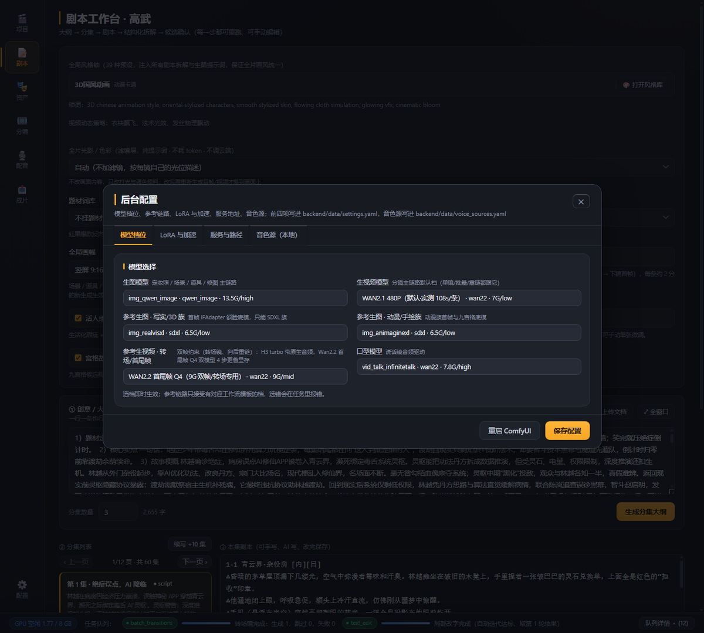 |
| 0b | **音色源（本地）**（音色清单从硬编码迁到 `data/voice_sources.yaml`：14 个内置 edge 音色 + 可增删的本地音色；全局切 edge-tts / 本地 HTTP 服务，带连接探测与逐条试听） | 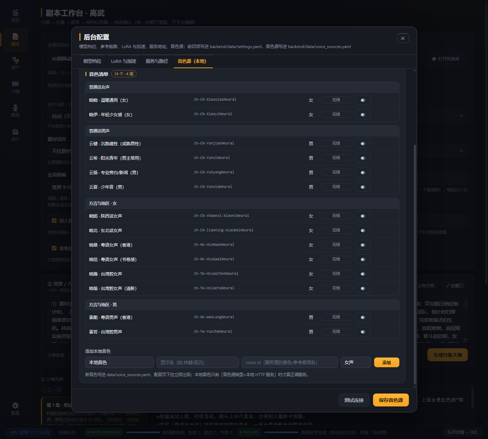 |
| 0c | **本地音色库**（1248 款真实录音参考音频（公开音色库 voice.jimu.chat，571MB）落到本机，按名称/编号/分类/标签搜索 + 性别与分类筛选 + 分页；试听直接播原声，"加入"或"批量加入本页"写进配音清单；分页条下方一排**分类整批写入**按钮（7 大分类一次进清单，约 1.6 秒）+「清空积木分组」撤销） | 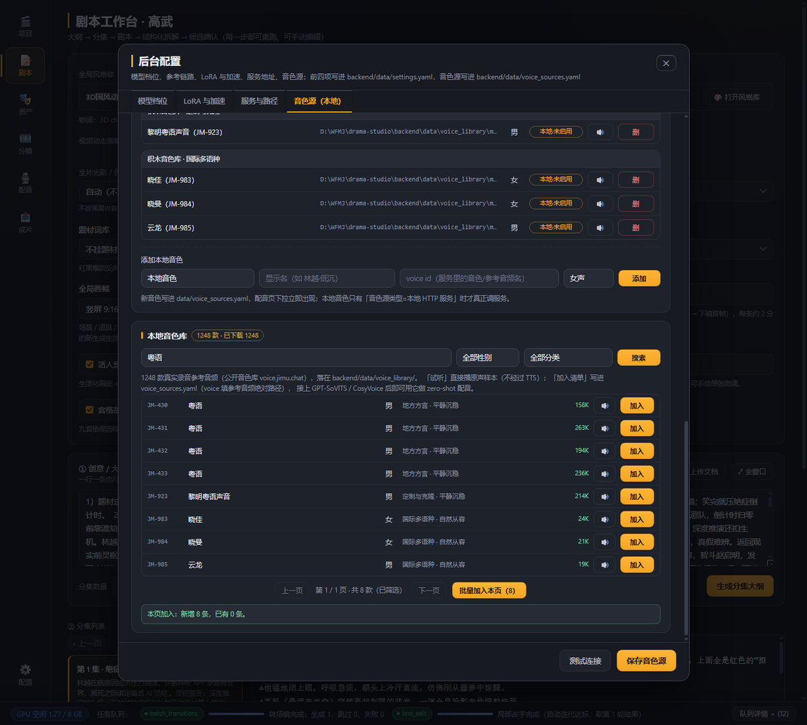 |
| 1 | **项目中心**（新建项目：名称 + 一句话描述；卡片直达工作台） | 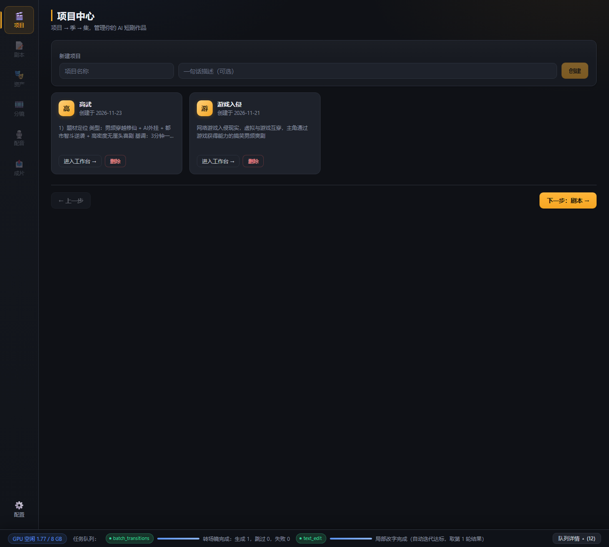 |
| 2 | **剧本工坊**（全局风格锁只读信息条 + 锁词 / 光影滤镜 / 题材词库 / 画幅与转场开关；大纲、分集列表、本集剧本同屏） |  |
| 2b | **风格库**（39 种可见风格 / 8 分类，卡片缩略图底部叠风格名，选中项右上角「当前」；点卡片整体切换风格锁） | 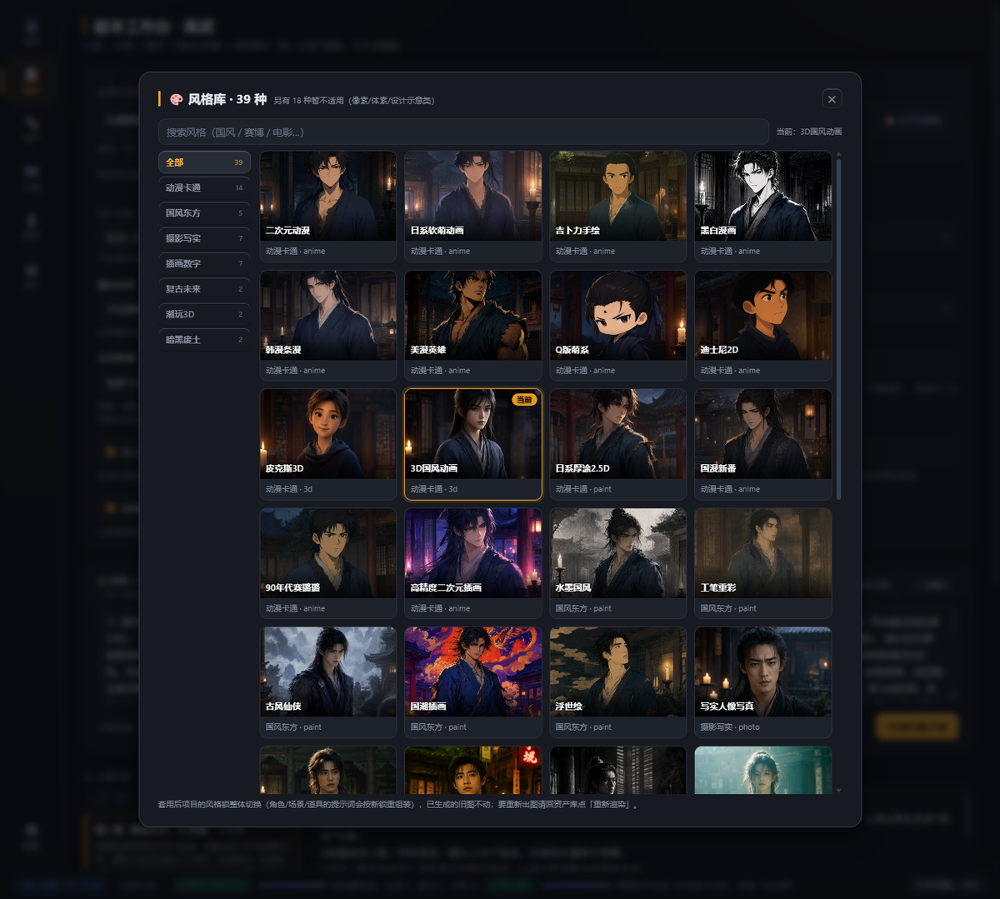 |
| 3 | **资产工坊**（角色设计图（三视图 + 表情 + 服装拆解）/ 场景设计图 / 道具设计图，图上「📝 改字」只重画框内文字） | 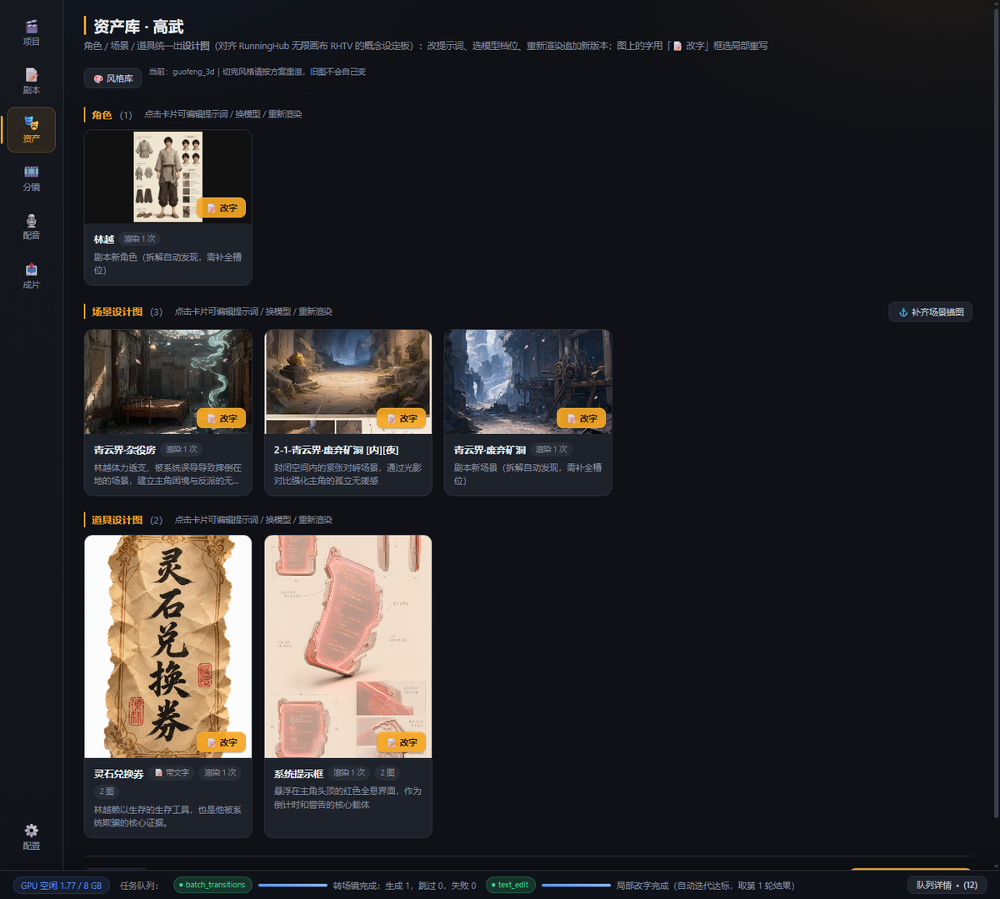 |
| 4 | **分镜时间轴**（逐镜镜头卡：首帧 / 尾帧 / 视频 / 说话镜、参考·动作·摄像、接力与向后重链、续写；顶部分镜进度条） | 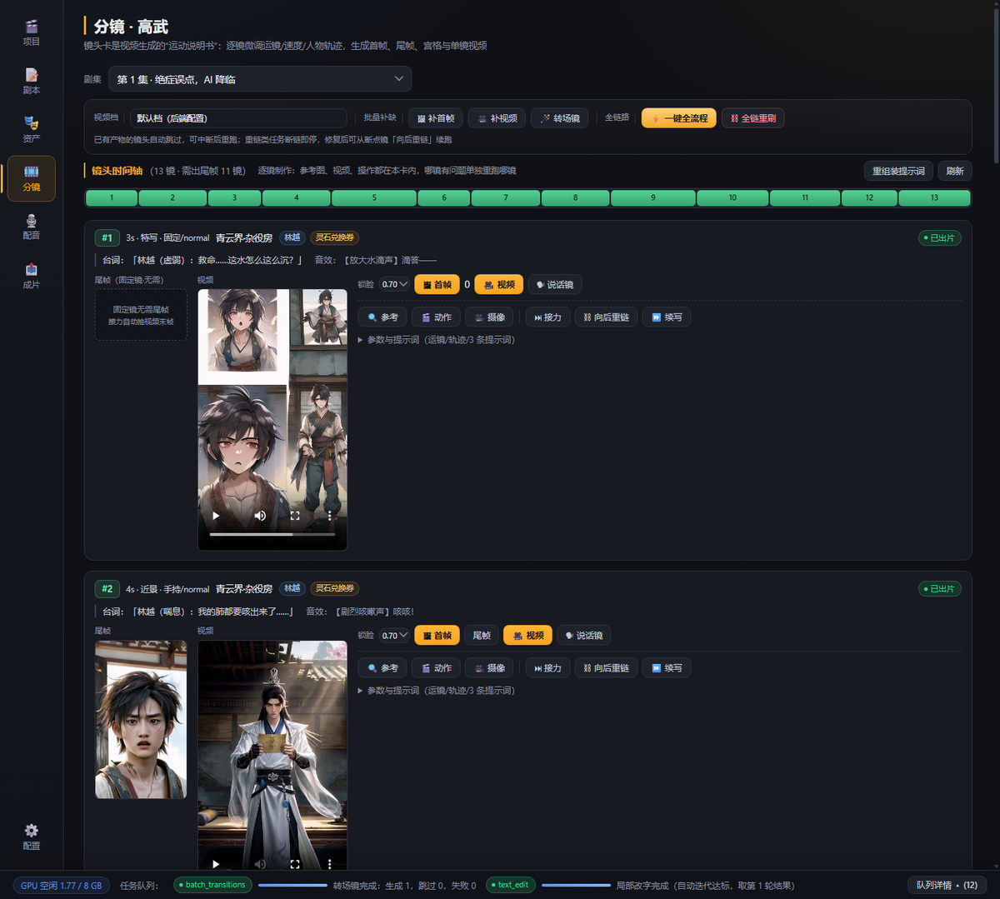 |
| 5 | **配音**（按角色锁定音色 + 语气层，逐句 edge-tts，零显存） | 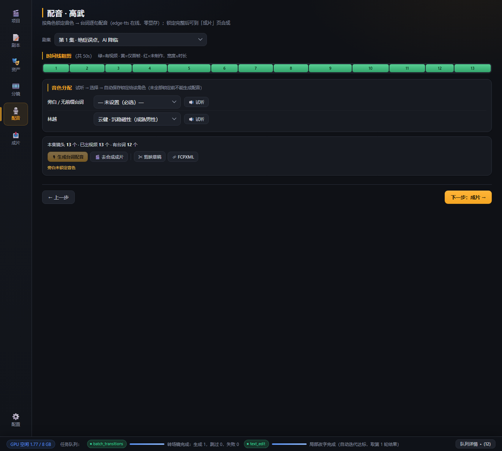 |
| 6 | **成片**（时间线粗剪：绿=有视频 / 黄=仅首帧；台词配音 → 混音 → SRT 字幕 → 剪映草稿 & FCPXML） | 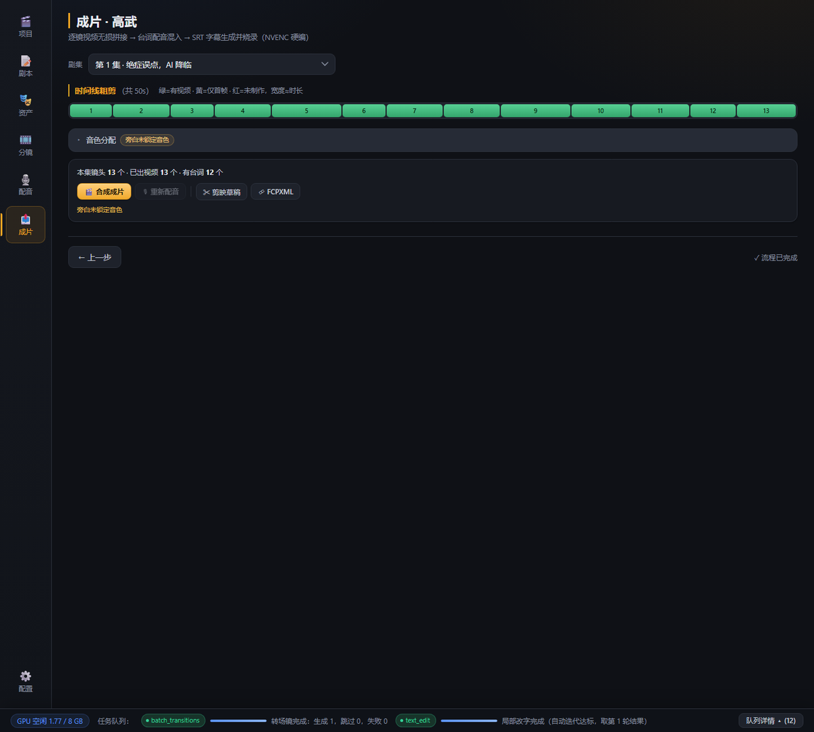 |
| 6b | **音频分轨**（成片页四轨编排：BGM 铺底 + 逐镜贴片音（动作/环境/人声），音效来自本地 Pixabay 音效库，支持跨轨检索；合成时 `amix` 与台词轨混合、BGM 循环铺满并首尾淡入淡出） | 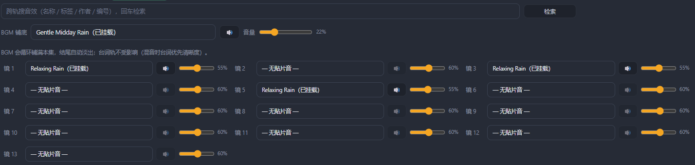 |
| 6c | **本地音效库**（设置页第 4 组：条数/体积 badge、逐条用途胶囊（环境·动作·人声·BGM 一键改轨）、试听） | 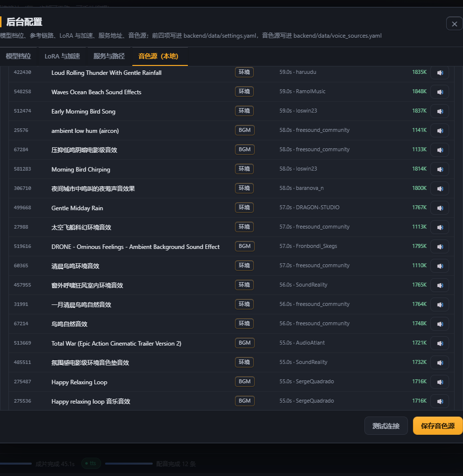 |
| 附 | **光影滤镜效果**（同镜头只换滤镜词块：左 黄金时刻 / 右 青橙电影调） | 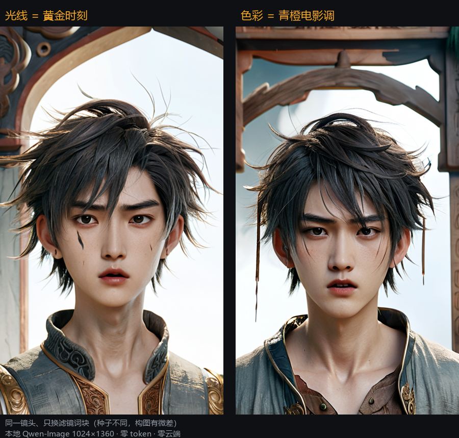 |

## License

本项目基于 [MIT License](LICENSE) 开源。
