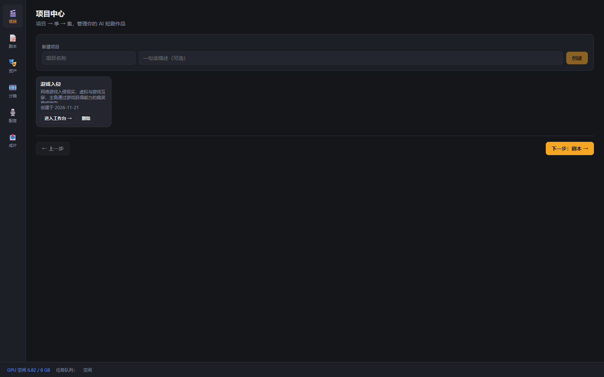
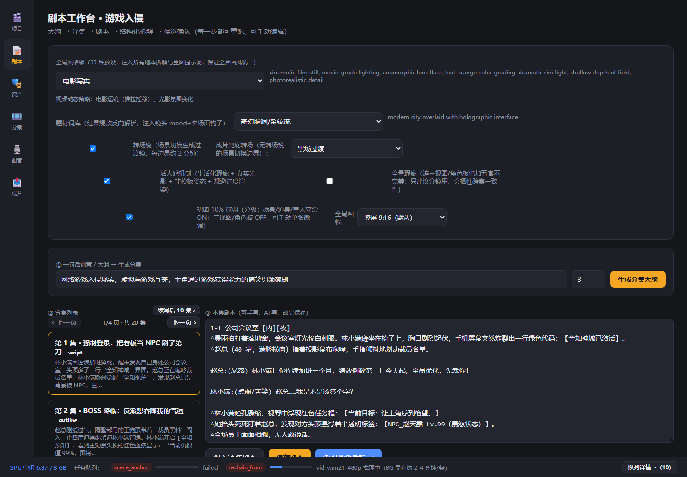
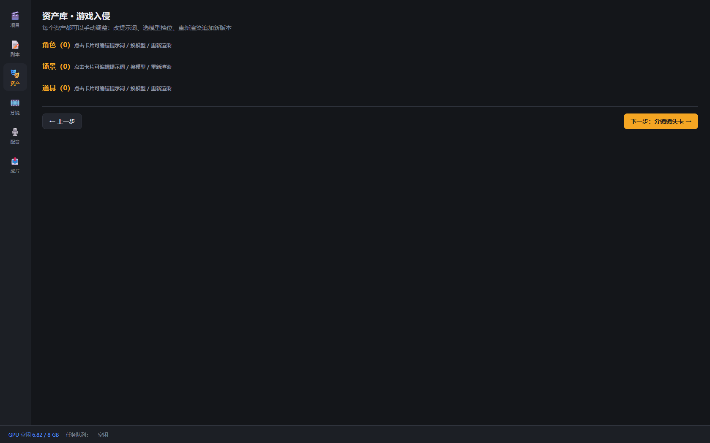
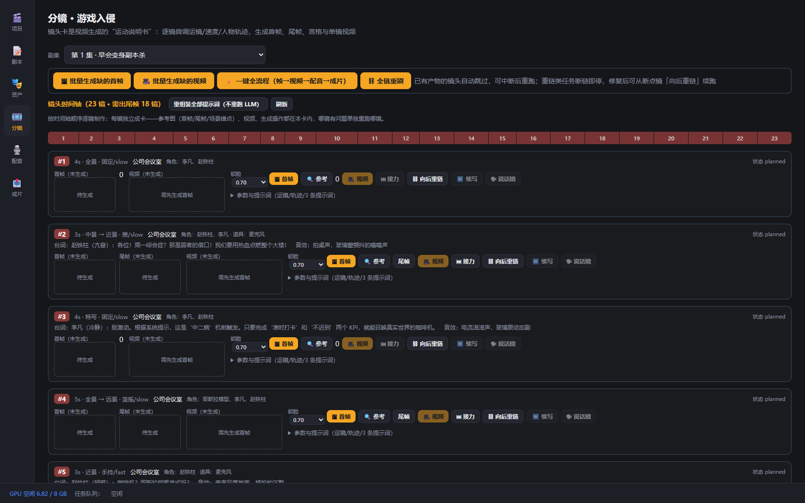
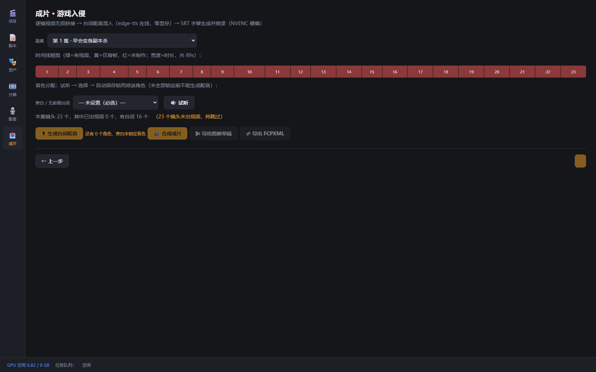

# Drama Studio — 纯本地 AI 短剧生产流水线

> **100% 本地生成**：剧本推理走本地 Ollama，画面/视频走本地 ComfyUI，配音走本地可调用的 edge-tts 免费音色引擎 —— **全流程零云端 API、零按次付费、数据不出本机**。
> 为 **8GB 显存笔记本 GPU（RTX 4070 Laptop）** 量身调优：显存感知选档 + 串行调度 + 显存卸载，高端模型也能跑。



## 标签 / Tags

`local-first` `ai-video` `short-drama` `comfyui` `ollama` `fastapi` `sdxl` `wan21` `infinitetalk` `ipadapter` `image-to-video` `storyboard` `film-production` `low-vram` `rtx-4070` `prompt-engineering` `vertical-drama` `face-consistency` `scene-anchoring` `motion-control`

---

## 用途

把**一句话创意**变成**成片 MP4** 的单机全流程工具：

```
一句话创意 → 分集大纲 → 标准格式剧本 → 导演级分镜拆解 → 角色定妆照（三视图）
→ 场景/道具资产 → 首帧/尾帧 → AI 视频（i2v） → 口型对齐说话镜头 → 配音混音 → 字幕烧录 → 成片
```

适用于：竖屏短剧创作、AI 叙事视频实验、低成本动画/写实短剧生产、ComfyUI 工作流工程化实践。
支持导出 **剪映草稿 JSON** 与 **FCPXML**（Premiere / DaVinci / FCPX 可导入），AI 生成 + 人工精剪两开花。

## 核心功能

| 模块 | 功能 | 技术 |
|---|---|---|
| 剧本工坊 | 一句话 → 高概念 → 分集大纲 → 标准剧本（场号/△动作行/紧凑对白/音效字幕）；**集数硬保证**（分批生成+自动补齐，最高 60 集，LLM 偷懒也凑满）；**续写分集**（保留已有集接写后 10 集，逐集自动 AI 写剧本，单集失败可单独重试）；分集列表分页浏览 | 本地 Ollama (qwen) |
| 导演拆解 | **大师级导演/编剧分镜**：12 条专业覆盖语法（定场镜/正反打+过肩/180° 轴线锁视线/反应镜/插入镜/cut-on-action）+ **竖屏留存波形节奏编排**（hook 开场钩子→压迫→激化→反转峰值→集尾 cliffhanger 五段情绪循环，拍点张力词直落提示词）+ 运镜多样性启发式兜底；角色**国家/地区形象**槽位（11 预设） | 规则解析 + LLM |
| 词库系统 | **风格词库**（26 个风格包：动漫 Danbooru 词系/仙侠/国风水墨/cyberpunk/VFX 特效四要素，负面链防风格串味）× **题材词库**（14 个红果爆款题材包反向解析：战神/赘婿/霸总/宫斗…，setting/wardrobe/mood/hooks/negative 五类，光比公式+名场面钩子词）× **打斗词库**（动作镜自动识别：打击=发力→接触→受击动量链编排词、追逐=动量+变向，负面挡假打/无重力/血腥）× **特效词库**（14 类特效镜自动识别：慢镜/时间静止/金光/气浪/爆炸/闪电/暴雨/雾/花瓣/光柱/狂风/碎裂/水花/闪回，特效必写环境反应防贴纸感，每镜封顶 2 种）双层正交叠加，角色三视图只取风格锚防特效污染设定图 | style_vocab.py / action_vocab.py / vfx_vocab.py |
| 角色资产 | 三视图定妆照**硬锁**（左半面部特写 + 右半正/侧/背全身 + 底部信息栏含角色名与配色卡）：默认 **Qwen-Image 2.1 整张版式一次成型**（转向/服装跨视图最准），SDXL 三视角拼版为备选通道；三视图版式全链路归一，任何入口不会漏出单人像 | Qwen-Image 2.1 int8 / SDXL |
| 一致性 | IPAdapter 锁脸（单人/双人链式双 IPA）+ **锁脸治理**（meta 感知判定不再误拒裁脸图、特写/像素面积择优喂参考、角色级默认脸锁钉死参考版本）+ 场景锚定图（**三级回退**：手动锚→iso 布局图→最新场景图，一键批量补齐）+ 末帧接力 | ComfyUI |
| 视频生成 | 双帧 i2v / 单帧续写 / 镜内延长（ffmpeg 无损拼接）；**六槽位身体部位级动作控制**（posture/gesture/expression/gaze/intensity/secondary）+ 运镜稳定性约束（no jitter/no morphing/feet not slide/单主力运镜） | Wan2.1 480P fp8 |
| 口型对齐 | 台词 → 逐句 TTS → 音频驱动说话视频，口型全程跟音频 | InfiniteTalk |
| 镜间转场 | **场景锁定默认开**（锚图 img2img 压同场景背景漂移）+ 同场景**末帧接力**（跨场景守卫：边界不接力改走场景锚图独立生成）+ **转场词双端注入**（match_cut/whip_pan/object_pass/light_flash：tail 词进上镜镜尾、head 词进本镜镜首，静帧保持干净）+ 可选**双帧转场镜**（场景边界上镜末帧→下镜首帧 i2v，1-2s，幂等批量任务）+ 成片**三级插入**（转场镜 → 黑场/白闪兜底段 → 硬切，含插入段自动 NVENC 重编码） | ComfyUI + ffmpeg |
| 配音成片 | 音色跨集锁定 + 语气层（11 种情绪映射语速音调）+ 混音 + SRT 烧录 | edge-tts + ffmpeg |
| 批量编排 | 一键全流程 / 断点续跑 / 向后重链 / 剪映 & FCPXML 导出 | FastAPI 编排 |
| 可视化 | 分镜时间轴、九宫格候选（仅动漫风格，写实禁用防糊）、参考溯源窗口、提示词模板编辑器 | React + Vite |

## 方法论（内建于代码，非文档）

系统不是"提示词生成器"，而是把一套短剧生产方法论**源码级落地**：

- **第三章 · 高概念公式**：熟悉设定 + 颠覆性反差 = 高概念；三幕剧拆集，每集解决一个具体矛盾、结尾设强钩子。**集数硬保证**：小模型对"共 N 集"服从度差（实测 4B 模型要 3 集只给 2 集），大纲按 6 集/批循环补齐；续写分集与重建式生成分离，重建清空重走、续写只追加。
- **第一章 · 影视标准格式**：场号仅在场景/时间切换时新增（严禁每节拍开新场）、动作行只写可视化内容、心理描写强制转动作。
- **导演覆盖语法 + 留存波形**：切镜从"八原则"升级为 12 条专业覆盖语法（正反打锁 180° 轴线、反应镜给戏眼、插入镜给证据、cut on action），节奏按竖屏留存波形编排（0-3s 钩子截停→压迫→激化→反转峰值→集尾 cliffhanger 留扣），拍点张力词注入提示词；LLM 偷懒全"固定慢"时由启发式重排兜底。
- **双层提示词词库**：风格词库（画风层：动漫 Danbooru 词系配"禁摄影词"负面、仙侠三段式、VFX 特效=颜色+形状+粒子+动势）× 题材词库（题材层：红果爆款反向解析的光比公式——甜宠 1-2:1/悬疑 6:1/权谋伦勃朗 10:1——与名场面钩子词），负面链自动防风格/题材串味。
- **运动动作控制**：六槽位身体部位级公式（谁+身体部位+做什么+朝向），I2V 遵循 Wan 官方运动公式——图定义实体、文只管运动，稳定性词必备。
- **第二章 · 九段式角色公式**：identity → appearance → face → hair → clothing → makeup → accessories → expression → pose，抽象形容词一律转为可视觉化符号（"帅气"→"嘴角微翘、下颌线利落"）。
- **道具三分类**：核心叙事 / 角色连接 / 环境氛围——氛围道具不独立生成并入场景，出现 ≥2 次的引用道具才自动晋升。
- **活人感五机制**：质感瑕疵（皮肤毛孔/发丝凌乱/布料褶皱）+ 物理光源（单一主光源+色温混合）+ 非模板姿态 + 10% 自动微调 + 防过度渲染负面词——专治"AI 塑料感"。三视图/定妆照自动切换身份安全版瑕疵，保跨集五官稳定。
- **风格锁按资产类型适配**：人像摄影词禁入道具/场景（避免"勺子→人脸"事故）；写实风格禁开宫格；空镜禁皮肤词。
- **双层模型方言层**：提示词从出生就长在目标模型的"母语"里——组装期按预判的下游模型组词（SDXL 短标签链 / Flux2-Klein 物理常识 / Qwen-Image 文字渲染 / Wan 动作分解式短语 / InfiniteTalk 口型同步微动作，SDXL 图像方言不泄漏进视频模型）；生成期再兜底一层（Wan 收 5s、短标签负面；Seedance 吃 `[Xs]` 节拍前缀；措辞按模型惯用语替换）。
- **连续性三机制**：动作三拍（trigger/peak/aftermath 决定首帧/尾帧/关键帧取材）+ 180° 轴线警告 + 前后镜承接摘要。
- **音色治理**：音色跨集唯一锁定 + 角色性别强匹配（女角色禁配男声）+ 11 种语气映射到语速/音调参数。

> 方法论源自对 10+ 开源 AI 视频工具（Jellyfish / ArcReel / Toonflow / moyin-creator 等）的源码级拆解与实战迭代，每条规则都标注了触发它的真实事故。

## 使用方法

### 环境要求

- Windows + NVIDIA GPU ≥ 8GB 显存（4GB 可跑低档，越高越好）
- [ComfyUI](https://github.com/comfyanonymous/ComfyUI)（Desktop 版或手动部署）运行在 `127.0.0.1:8188`
- [Ollama](https://ollama.com) 运行在 `127.0.0.1:11434`，拉取 `qwen3.5:4b`（或任意本地 LLM，改 `script_service.py` 默认模型）
- Python 3.11+、Node.js 18+

### 安装

```bash
# 后端
cd backend
python -m venv .venv
.venv\Scripts\pip install -r requirements.txt

# 前端
cd ../frontend
npm install
npm run build          # 产物由后端静态托管，构建一次即可

# 一键启动（首次自动建环境装依赖）
start.bat              # 浏览器打开 http://127.0.0.1:8766
```

### 配置

1. **模型注册表**：复制 `backend/data/models.example.yaml` 为 `backend/data/models.yaml`，把 `weight` 改成你 ComfyUI `models` 目录里实际存在的权重文件名。
2. **本机路径**（可选）：`backend/app/config.py` 支持环境变量覆盖——
   - `DRAMA_COMFYUI_INPUT_DIR`：ComfyUI input 共享目录
   - `DRAMA_FFMPEG`：ffmpeg 路径（默认自动探测 PATH，回退 ComfyUI Desktop 自带版）
3. **工作流**：`backend/workflows/*.json` 均为 ComfyUI **API 格式**模板，节点名与你的 custom_node 版本不一致时可在 ComfyUI 里「导出(API)」后同名替换。

### 生产流程（UI 引导式）

1. **新建项目**：填一句话描述（自动带入剧本页）+ 选风格（30+ 预设）+ 全局画幅
2. **剧本页**：生成分集大纲（集数硬保证）→ 写剧本 → 一键拆解（产出镜头卡 + 候选角色/场景/道具）；集数不够点「续写后 10 集」自动接写并逐集出剧本
3. **资产页**：确认候选 → 生成角色三视图（Qwen-Image 整张版式，可给角色设国家形象） / 场景 / 道具（角色音色自动分配，试听后锁定）
4. **分镜页**：逐镜或批量出首帧（IPA 锁脸）→ 尾帧 → i2v 视频；说话镜自动走 InfiniteTalk 口型对齐
5. **成片**：一键全流程 → TTS 配音 → 混音烧字幕 → 导出剪映草稿 / FCPXML

## 架构

```
backend/
  app/
    api.py               # FastAPI 全部路由
    db.py                # SQLAlchemy 模型 + 轻量迁移
    style_presets.py     # 30+ 风格预设 / 方法论提示词组装 / 活人感词库
    style_vocab.py       # 双层词库：26 风格包 × 14 红果爆款题材包（风格/题材/负面词）
    aspect.py            # 全局画幅桶（SDXL 分辨率桶 + IPA 压长边策略）
    adapters/            # ComfyUI（D 范式结构化覆盖）/ Ollama 适配器
    scheduler/           # 串行任务队列 + SSE + 显存感知选档
    services/
      script_service.py  # 剧本/拆解/提示词组装/模板引擎接入
      shot_service.py    # 首尾帧/i2v/宫格/接力/续写/InfiniteTalk
      asset_service.py   # 定妆照/三视图/超分/img2img 重绘
      voice_service.py   # TTS/语气层/音色治理/成片合成
      pipeline_service.py# 批量编排/剪映&FCPXML 导出
      continuity.py      # 动作节拍/轴线/承接
      dialects.py        # 模型方言层（生成期兜底：时长/负面/收尾约束）
      model_vocab.py     # 模型提示词库（组装期预判下游模型并按模型习惯组词）
      action_vocab.py    # 打斗词库（动作镜自动识别：打击/追逐动量链编排词）
      vfx_vocab.py       # 特效词库（14 类特效镜识别：慢镜/金光/气浪/爆炸…）
  workflows/             # 13 个 ComfyUI API 工作流模板
frontend/
  src/App.jsx            # 单文件 React 应用（剧本/资产/分镜/成片四页面）
```

## 已验证的低显存实测数据（RTX 4070 Laptop 8GB）

| 任务 | 配置 | 耗时 |
|---|---|---|
| SDXL 出图 | RealVisXL V5 fp16, 480x832 | ~30s |
| **Qwen-Image 2.1 三视图整张版式** | int8 convrot + offload, 1344x768（左特写+正/侧/背+信息栏一次成型） | ~8 min |
| SDXL 三视角拼版三视图 | 正/侧/背 3 次出图 + 背面 img2img + PIL 拼版 | ~5 min |
| Wan2.1 i2v 33 帧 | 480P fp8 + 4 步蒸馏 LoRA | ~108s |
| InfiniteTalk 说话镜 49 帧窗口 | fp8 + BlockSwap 30 块 | ~85 min/窗口 |
| Flux2-Klein 4B 出图 | fp8 offload | ~3-4 min |
| 续写 10 集大纲 + 逐集剧本 | qwen3.5:4b 分批（2 批大纲 + 10 集剧本） | ~9 min |

## 许可与声明

- 代码随取随用；**模型权重不在本仓库**，请遵循各底模（SDXL/Flux/Wan/Qwen）自身的许可协议。
- edge-tts 音色为微软免费接口，纯本地调用无密钥；商用前请自行确认合规边界。

## 演示截图

> 以下截图来自真实生产会话（演示项目：《游戏入侵》，电影写实风格，20 集 / 第 1 集 17 镜完整生产链）。

| 模块 | 截图 |
|---|---|
| 项目中心（一句话描述 → 全局画幅） |  |
| 剧本工坊（创意带入 / 风格锁 / 活人感开关） |  |
| 资产工坊（角色三视图 / 音色锁定） |  |
| 分镜时间轴（17 镜镜头卡 / 批量编排 / 说话镜） |  |
| 成片导出（配音 / 混音 / 剪映 & FCPXML） |  |

## License

本项目基于 [MIT License](LICENSE) 开源。
