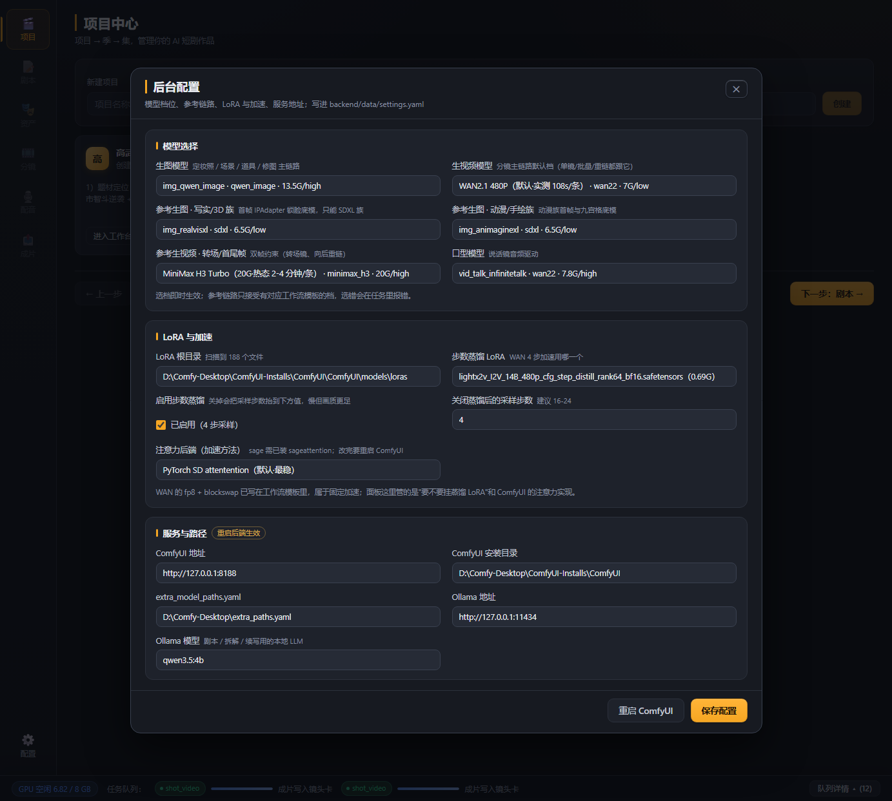

# Drama Studio — 纯本地 AI 短剧生产流水线

> **100% 本地生成**：剧本推理走本地 Ollama，画面/视频走本地 ComfyUI，配音走本地可调用的 edge-tts 免费音色引擎 —— **全流程零云端 API、零按次付费、数据不出本机**。
> 为 **8GB 显存笔记本 GPU（RTX 4070 Laptop）** 量身调优：显存感知选档 + 串行调度 + 显存卸载，高端模型也能跑。
> 所有底模档位、参考链路模型、LoRA 目录、加速方法与服务地址都能在界面左侧 **「⚙️ 配置」后台面板**里改，不用动代码。


## 标签 / Tags

`local-first` `ai-video` `short-drama` `comfyui` `ollama` `fastapi` `sdxl` `wan21` `infinitetalk` `ipadapter` `image-to-video` `storyboard` `film-production` `low-vram` `rtx-4070` `prompt-engineering` `vertical-drama` `face-consistency` `scene-anchoring` `motion-control`

---

## 用途

把**一句话创意**变成**成片 MP4** 的单机全流程工具：

```
一句话创意 → 分集大纲 → 标准格式剧本 → 导演级分镜拆解 → 角色定妆照（三视图）
→ 场景/道具资产 → 首帧/尾帧 → AI 视频（i2v） → 口型对齐说话镜头 → 配音混音 → 字幕烧录 → 成片
```

适用于：竖屏短剧创作、AI 叙事视频实验、低成本动画/写实短剧生产、ComfyUI 工作流工程化实践。
支持导出 **剪映草稿 JSON** 与 **FCPXML**（Premiere / DaVinci / FCPX 可导入），AI 生成 + 人工精剪两开花。

## 核心功能

按生产链路分为六大类：**创作 → 词库 → 资产 → 视频 → 成片 → 工程**。

### 一、剧本与分镜创作

| 模块 | 功能 | 技术 |
|---|---|---|
| 剧本工坊 | 一句话 → 高概念 → 分集大纲 → 标准剧本（场号/△动作行/紧凑对白/音效字幕）；**集数硬保证**（分批生成+自动补齐，最高 60 集，LLM 偷懒也凑满）；**续写分集**（保留已有集接写后 10 集，逐集自动 AI 写剧本，单集失败可单独重试）；分集列表分页浏览；**大纲输入支持多行文本 + 全窗口弹层编辑（不设字数上限）+ 上传本地 txt/md 全文自动填入**（UTF-8 优先、乱码回落 GB18030，兼容国内 GBK 小说文本） | 本地 Ollama (qwen) |
| 导演拆解 | **大师级导演/编剧分镜**：12 条专业覆盖语法（定场镜/正反打+过肩/180° 轴线锁视线/反应镜/插入镜/cut-on-action）+ **竖屏留存波形节奏编排**（hook 开场钩子→压迫→激化→反转峰值→集尾 cliffhanger 五段情绪循环，拍点张力词直落提示词）+ 运镜多样性启发式兜底；角色**国家/地区形象**槽位（11 预设） | 规则解析 + LLM |

### 二、提示词词库引擎（双层正交叠加）

| 词库 | 功能 | 实现 |
|---|---|---|
| 风格词库 | 26 个风格包：动漫 Danbooru 词系/仙侠/国风水墨/cyberpunk/VFX 特效四要素，负面链防风格串味 | style_vocab.py |
| 题材词库 | 14 个红果爆款题材包反向解析：战神/赘婿/霸总/宫斗…，setting/wardrobe/mood/hooks/negative 五类，光比公式+名场面钩子词 | style_vocab.py |
| 打斗词库 | 动作镜自动识别：打击=发力→接触→受击动量链编排词、追逐=动量+变向，负面挡假打/无重力/血腥 | action_vocab.py |
| 特效词库 | 14 类特效镜自动识别：慢镜/时间静止/金光/气浪/爆炸/闪电/暴雨/雾/花瓣/光柱/狂风/碎裂/水花/闪回，特效必写环境反应防贴纸感，每镜封顶 2 种 | vfx_vocab.py |
| 模型方言库 | 按下游模型组词：Qwen-Image（自然语言长描述/文字渲染/版式跟随）、MiniMax H3（I2V 运动+运镜+氛围音，cfg=1 无负面故全正向）、wan/infinitalk 备用档 | model_vocab.py |
| 自强化词库 | 种子词块 + kept/failed 权重学习：产物提示词反查命中计数，kept≥2 转正、failed≥3 且 kept=0 拉黑；`POST /api/prompt-bank/harvest` 从现存成功产物提炼（过滤画质尾巴/剧情UI词/跨族方言/光照词，视频库只收运镜-物理-氛围类） | prompt_bank.py |

> 双层叠加规则：画风层 × 题材层正交组合；角色三视图只取风格锚，防特效/题材词污染设定图。模型方言层（组装期按下游模型组词 + 生成期兜底）详见下方方法论。

### 三、资产生成与一致性

| 模块 | 功能 | 技术 |
|---|---|---|
| 角色资产 | 三视图定妆照**硬锁**（左半面部特写 + 右半正/侧/背全身 + 底部信息栏含角色名与配色卡）：默认 **Qwen-Image 2.1 整张版式一次成型**（转向/服装跨视图最准），SDXL 三视角拼版为备选通道；三视图版式全链路归一，任何入口不会漏出单人像 | Qwen-Image 2.1 int8 / SDXL |
| 一致性锁 | IPAdapter 锁脸（单人/双人链式双 IPA）+ **锁脸治理**（meta 感知判定不再误拒裁脸图、特写/像素面积择优喂参考、角色级默认脸锁钉死参考版本） | ComfyUI |
| 场景锚定 | 场景锚定图**三级回退**（手动锚→iso 布局图→最新场景图，一键批量补齐）+ 末帧接力，跨镜背景漂移压制 | ComfyUI |
| 道具/场景 | 道具三分类（核心叙事/角色连接/环境氛围——氛围道具并入场景不独立生成）；实物资产真实参考图 img2img 重绘通道 | ComfyUI |

### 四、视频生成

| 模块 | 功能 | 技术 |
|---|---|---|
| 首帧/宫格 | 双帧 i2v 首帧（IPA 锁脸）/ 尾帧 / 九宫格候选构图（**仅动漫风格，写实禁用防糊**，裁单格作首帧） | ComfyUI |
| i2v 视频 | Wan2.1 双帧 i2v / 单帧续写 / 镜内延长（ffmpeg 无损拼接）；**六槽位身体部位级动作控制**（posture/gesture/expression/gaze/intensity/secondary）+ 运镜稳定性约束（no jitter/no morphing/feet not slide/单主力运镜） | Wan2.1 480P fp8 |
| 口型对齐 | 台词 → 逐句 TTS → 音频驱动说话视频，口型全程跟音频 | InfiniteTalk |
| 镜间转场 | **场景锁定默认开**（锚图 img2img 压同场景背景漂移）+ 同场景**末帧接力**（跨场景守卫：边界不接力改走场景锚图独立生成）+ **转场词双端注入**（match_cut/whip_pan/object_pass/light_flash）+ 可选**双帧转场镜**（场景边界上镜末帧→下镜首帧 i2v，幂等批量任务）+ 成片**三级插入**（转场镜 → 黑场/白闪兜底段 → 硬切） | ComfyUI + ffmpeg |

### 五、配音与成片导出

| 模块 | 功能 | 技术 |
|---|---|---|
| 配音成片 | 音色跨集锁定 + 角色性别强匹配 + 语气层（11 种情绪映射语速音调）+ 混音 + SRT 烧录（NVENC 硬编） | edge-tts + ffmpeg |
| 批量编排 | 一键全流程（首帧→视频→配音→成片）/ 断点续跑 / 向后重链 / 断链即停 | FastAPI 编排 |
| 外部导出 | **剪映草稿 JSON** 与 **FCPXML**（Premiere / DaVinci / FCPX 可导入），AI 生成 + 人工精剪两开花 | pipeline_service |

### 六、工程与可视化

| 模块 | 功能 | 技术 |
|---|---|---|
| 任务系统 | 串行队列 + SSE 实时进度 + 页面重开任务回放（重连全量对账 + 15s 兜底轮询，防断线旧快照）+ 暂停/取消/继续；三态区分 `failed`（真实报错）与 `interrupted`（服务重启/离线/ComfyUI 不可达，参数保留可继续）；显存感知选档（8GB 友好） | FastAPI + SSE |
| 可视化 | 分镜时间轴（镜头卡：参考图/提示词/参数全溯源）、参考溯源窗口（可换角色/场景参考）、提示词模板编辑器、全局画幅设置（16:9/21:9/4:3/9:16/3:4/1:1）；生成设置区为两列自适应网格（标题→控件→说明三段式，开关做状态卡片，开启高亮） | React + Vite |
| 图片增强 | 单张超分放大（upscale 工作流）、初图 10% 自动微调 | ComfyUI |
| 后台配置 | 左侧导航「⚙️ 配置」一个入口管全部参数：6 个模型档（生图 / 生视频主链路 / 写实参考生图 / 动漫参考生图 / 参考生视频 / 口型）、LoRA 根目录与 4 步蒸馏 LoRA、注意力后端（PyTorch / SageAttention）、WAN 采样步数、ComfyUI 与 Ollama 服务地址。模型档即时生效；安装目录/extra_paths/注意力重启 ComfyUI（守护进程现读配置）；服务地址重启后端。保存时校验档位与 family，写错当场拒绝 | settings.py + `/api/settings` |

## 方法论（内建于代码，非文档）

系统不是"提示词生成器"，而是把一套短剧生产方法论**源码级落地**：

- **第三章 · 高概念公式**：熟悉设定 + 颠覆性反差 = 高概念；三幕剧拆集，每集解决一个具体矛盾、结尾设强钩子。**集数硬保证**：小模型对"共 N 集"服从度差（实测 4B 模型要 3 集只给 2 集），大纲按 6 集/批循环补齐；续写分集与重建式生成分离，重建清空重走、续写只追加。
- **第一章 · 影视标准格式**：场号仅在场景/时间切换时新增（严禁每节拍开新场）、动作行只写可视化内容、心理描写强制转动作。
- **导演覆盖语法 + 留存波形**：切镜从"八原则"升级为 12 条专业覆盖语法（正反打锁 180° 轴线、反应镜给戏眼、插入镜给证据、cut on action），节奏按竖屏留存波形编排（0-3s 钩子截停→压迫→激化→反转峰值→集尾 cliffhanger 留扣），拍点张力词注入提示词；LLM 偷懒全"固定慢"时由启发式重排兜底。
- **双层提示词词库**：风格词库（画风层：动漫 Danbooru 词系配"禁摄影词"负面、仙侠三段式、VFX 特效=颜色+形状+粒子+动势）× 题材词库（题材层：红果爆款反向解析的光比公式——甜宠 1-2:1/悬疑 6:1/权谋伦勃朗 10:1——与名场面钩子词），负面链自动防风格/题材串味。
- **运动动作控制**：六槽位身体部位级公式（谁+身体部位+做什么+朝向），I2V 遵循 Wan 官方运动公式——图定义实体、文只管运动，稳定性词必备。
- **第二章 · 九段式角色公式**：identity → appearance → face → hair → clothing → makeup → accessories → expression → pose，抽象形容词一律转为可视觉化符号（"帅气"→"嘴角微翘、下颌线利落"）。
- **道具三分类**：核心叙事 / 角色连接 / 环境氛围——氛围道具不独立生成并入场景，出现 ≥2 次的引用道具才自动晋升。
- **活人感五机制**：质感瑕疵（皮肤毛孔/发丝凌乱/布料褶皱）+ 物理光源（单一主光源+色温混合）+ 非模板姿态 + 10% 自动微调 + 防过度渲染负面词——专治"AI 塑料感"。三视图/定妆照自动切换身份安全版瑕疵，保跨集五官稳定。
- **风格锁按资产类型适配**：人像摄影词禁入道具/场景（避免"勺子→人脸"事故）；写实风格禁开宫格；空镜禁皮肤词。#84 强化：非角色资产按词块剔除人像词（眼睛/皮肤/发丝/服饰），人形排除走负向词链（正向 "no people" 对 SDXL 无效反而引人物）。
- **风格→底模自动映射**：photo→RealVisXL（道具/场景自动档走 Flux2-Klein，实物理解更强）/ **anime·paint→AnimagineXL 3.1**（真 SDXL 动漫底模 6.5G，AnythingXL 降为回退）/ **3D 族（Pixar·国风3D·游戏CG）→ Qwen-Image**（cel 3D 动画质感，13.5GB 靠 offload 在 8G 卡可跑）；改全局风格锁时存量实体提示词自动按新锁重算。这四类默认档在后台配置面板可逐项改。
- **全局底模切换（#87，2026-11-26 按显存分层修正）**：图片四角色（portrait/scene/prop/image_edit）默认走 **Qwen-Image**；视频默认档改成 **WAN2.1 480P**（fp8 + 4 步蒸馏 LoRA，实测 108s/条）——**MiniMax H3**（原生 UNetLoader 加载 fl2va pruned int8 + qwen3vl-32b nvfp4 文本编码器，24fps 原生音频，帧数对齐 17k+5 网格，BasicGuider cfg=1 无负面）用的是同一份 20GB int8 底模，8G 卡全靠分页，冷启首条 >40 分钟、长采样还可能把进程打死，因此 H3 降为**高质量档**（`vid_h3_turbo` / `vid_h3_int8`，显存 ≥16G 或单镜要 H3 音视频 latent 时在面板切回去即可）。辅助链路保持专用模型：分镜首帧/宫格/polish 锁 SDXL（IPA 锁脸依赖）、InfiniteTalk 口型镜不受全局默认影响；显式 model_key / prefer_tier 仍优先于任何默认（含面板配置）。
- **H3 turbo 提速档（#88）**：`vid_h3_turbo` = 同款 int8 底模（缓存复用）+ fl2v_turbo_8step LoRA（官方配 4 步采样），实测 2s 视频 30 分钟 → **4 分钟**（约 7.5 倍），画质略降；API `POST /shots/{id}/video` 传 `model_key: "vid_h3_turbo"` 即用。转场镜已迁到 H3 turbo 双帧（首=A末帧、尾=B首帧，`video_h3_turbo.json` 模板双 LoadImage 默认连接 first/last frame），wan22 双帧链路保留作回退。
- **成片拼接参数自适应（#89）**：wan 旧片（480x832@16fps）与 H3 新片（768x1344@24fps）混合时 concat demuxer 必坏——导出前逐段 ffprobe 探测分辨率/帧率，全段一致走 `-c copy` 无损快路，混合参数走 concat filter（scale/pad 对齐首段 + fps 归一）NVENC 重编码一次；批量视频/重链/一键全流程均支持 `model_key` 直通（不传走全局默认，混拼成片依然稳）。注：视频原生音频在成片合成中按既有设计丢弃，音轨统一由 TTS 配音重建（InfiniteTalk 口型片音频与 TTS 同源，同步不受影响）。
- **双模型提示词库 + 自强化（#90）**：拆解期生图按 **Qwen-Image 习惯**组词（自然语言长描述分层、文字渲染/版式跟随只给角色板与道具、场景图剔除文字指令防乱码）、生视频按 **MiniMax H3 习惯**组词（连续镜/运镜短语/动作分解/氛围音，全正向表述）。新增 `prompt_bank.json` 学习层：种子词块随代码内置，生成成功 kept+1、失败 failed+1，权重 = kept - 1.5*failed，实战提炼块优先于内置种子；`POST /api/prompt-bank/harvest` 扫描现存产物提炼词块（拦截画质尾巴/剧情 UI 词/跨族方言/光照词定性，视频库只收运镜-物理-氛围类，防"室内荧光灯"词块粘到"正午阳光"镜头）；视频侧同步剔除图像画质尾词与活人感锁（含否定句，H3 cfg=1 无效），180° 轴线提示改正向表述。API：`GET /api/prompt-bank`（权重视图）、`POST /api/prompt-bank/chunk`（手动增删）。
- **首帧底模按风格族对齐（#91）**：分镜首帧必须走 SDXL IPAdapter 锁脸通道，但底模此前只传 `style_family` 不点名——3D 国风在 SDXL 池内没有任何模型带 `3d` 标签，匹配落空后按档位平局取字典首个 = AnythingXL 动漫底模，于是 3D 项目首帧出成 2D 动漫人物；H3/Wan 是 I2V，直接继承首帧像素 → 视频角色与 Qwen-Image 生成的角色板"换人换画风"。现按风格族点名底模（3d/photo → RealVisXL 写实、anime/paint → AnimagineXL 3.1 动漫），写实负面锁（different face / plastic skin / distorted face）同步扩展到 3D；三视图裁脸区域从 0.5×0.85 收到 0.36×0.72，只取头肩特写（原区域会把右侧全身像一起裁进参考图，IPAdapter 学成混合版式、锁脸信号被稀释），角色可另存纯脸 `face_lock_path` 钉死版本。实测：首帧与角色板同一张脸，视频第 0 帧与首帧逐像素级同源，1.2s 处无换脸无脸崩。注：IPA 权重 0.8 会把参考图构图（半身）带进首帧，要按分镜 wide shot 出建议降到 0.7。
- **队列噪声治理与 interrupted 语义（#92）**：服务启动时的僵尸收尸旧逻辑把遗留 `running/pending` 一律标 `failed`——H3 单条 15–30 分钟，碰上改代码重启就凭空多一条红色失败（线上 45 条 failed 有 24 条是这个来源，队列里"失败进程一直出现"）。现改标 `interrupted`（琥珀「已中断」，参数原样保留，点「继续」按原参数重派；真实报错仍走 `failed`），并给了历史迁移脚本 `scripts/migrate_failed_to_interrupted.py`（默认预览、`--apply` 写库）。ComfyUI 不在时任务以 `httpx.ConnectError: All connection attempts failed` 收场，为此补了 `ComfyUI-Backend`（登录后 30s 拉起）与 `ComfyUI-Watchdog`（每 2 分钟探活 8188）两个计划任务，共用幂等脚本 `run_comfyui.vbs`（8188 已应答或已有 ComfyUI 进程即退出，防加载期重复拉起抢端口）。前端补 SSE 重连全量对账 + 15 秒兜底轮询，修掉断线后页面停在旧快照的"running 100%"假状态。
- **大纲输入工程化（#93）**：单行 `input` 装不下整本设定——改多行 textarea（不设字数上限、可拖拽）、加全窗口弹层（Esc/点遮罩关闭、与主输入框实时双向同步）、加本地 txt/md 上传读取；编码先按 UTF-8 解码，替换符（\uFFFD）超 20 个即回落 `gb18030` 重解（国内 txt 多为 GBK，直读必整篇乱码，实测双编码均正确还原）。生成设置区由「7 个开关 + 2 个下拉」挤在一个 flex row（换行后 checkbox 与文案完全错位）改为两列自适应网格：每格标题→控件→说明三段式，开关做成带边框的状态卡片、开启琥珀高亮，长括号说明下沉为 hint 小字。
- **双层模型方言层**：提示词从出生就长在目标模型的"母语"里——组装期按预判的下游模型组词（SDXL 短标签链 / Flux2-Klein 物理常识 / Qwen-Image 文字渲染 / Wan 动作分解式短语 / InfiniteTalk 口型同步微动作，SDXL 图像方言不泄漏进视频模型）；生成期再兜底一层（Wan 收 5s、短标签负面；Seedance 吃 `[Xs]` 节拍前缀；措辞按模型惯用语替换）。
- **连续性三机制**：动作三拍（trigger/peak/aftermath 决定首帧/尾帧/关键帧取材）+ 180° 轴线警告 + 前后镜承接摘要。
- **音色治理**：音色跨集唯一锁定 + 角色性别强匹配（女角色禁配男声）+ 11 种语气映射到语速/音调参数。
- **全程序审查（#95）**：对着配置面板逐项回查"面板有没有真接线"，挖出 5 个真 bug 并修：①注意力后端改成 sage 后点「重启 ComfyUI」仍以 pytorch 起（启动参数是 import 期常量）——改为守护进程每次拉起现读配置；②面板的「蒸馏 LoRA 文件」选择只存不读——现在只接管 wan2.1 480P 蒸馏族节点，双帧 wan2.2 高低噪与 H3 turbo 模板不受影响；③关闭蒸馏时的采样步数默认写成 4（等于关了还是 4 步必糊）——默认抬到 20、夹在 1-80；④Ollama 模型选择只存不读——`effective_model()` 统一兜底；⑤PUT 可写入非法档位（如把 Qwen 塞进参考生图），要等任务跑到 ComfyUI 才 400——保存时就校验 registry/role/family 并拒绝。另修：写实族触发九宫格时 RealVisXL 无 grid9 角色导致整条任务 failed（改为回退带 grid9 的 SDXL 档）、`"false"` 字符串被 `bool()` 判成 True、前端全量回传导致每次保存都提示"重启后端+重启 ComfyUI"（改为只提交变化键 + 后端按实际变化判 need_restart）。验证：38 条 GET 路由冒烟 0 异常、pyflakes 无未定义名、加速开关与 LoRA 替换用假 ComfyUI 客户端抓提交体逐条核对。
- **后台配置面板（#94）**：模型档散落在 `models.yaml` / 选档逻辑 / 工作流里，改一处要动代码——现在左侧导航底部「⚙️ 配置」一个入口全管：六个模型档（生图 / 生视频主链路 / 写实参考生图 / 动漫参考生图 / 参考生视频 / 口型）、LoRA 根目录（面板直接扫出全部 safetensors，当前 188 个）、4 步蒸馏 LoRA 选择与开关、WAN 采样步数、注意力后端（PyTorch / SageAttention）、ComfyUI 与 Ollama 服务地址。配置写 `backend/data/settings.yaml`（运行时生成、不进 git），`pick_model` 在 models.yaml 默认之前读它，显式 model_key / prefer_tier 仍优先；服务地址在进程最早期写进 `os.environ` 供 `config.py` 读取，注意力开关直接转译成 ComfyUI 的 `--use-sage-attention` 启动参数。模型档即时生效，服务地址与路径重启后端，注意力重启 ComfyUI（面板内置一键重启，队列忙时拒绝）。API：`GET/PUT /api/settings`、`GET /api/settings/loras`、`POST /api/settings/restart-comfy`。

> 方法论源自对 10+ 开源 AI 视频工具（Jellyfish / ArcReel / Toonflow / moyin-creator 等）的源码级拆解与实战迭代，每条规则都标注了触发它的真实事故。

## 使用方法

### 环境要求

- Windows + NVIDIA GPU ≥ 8GB 显存（4GB 可跑低档，越高越好）
- [ComfyUI](https://github.com/comfyanonymous/ComfyUI)（Desktop 版或手动部署）运行在 `127.0.0.1:8188`
- [Ollama](https://ollama.com) 运行在 `127.0.0.1:11434`，拉取 `qwen3.5:4b`（或任意本地 LLM —— 在「⚙️ 配置」的「Ollama 模型」下拉里换，或改 `script_service.py` 默认模型）
- Python 3.11+、Node.js 18+

### 安装

```bash
# 后端
cd backend
python -m venv .venv
.venv\Scripts\pip install -r requirements.txt

# 前端
cd ../frontend
npm install
npm run build          # 产物由后端静态托管，构建一次即可

# 一键启动（首次自动建环境装依赖）
start.bat              # 浏览器打开 http://127.0.0.1:8766
```

### 开机自启（Windows 登录后后台静默拉起）

`scripts/run_backend.vbs` 用 WScript 隐藏窗口方式启动 uvicorn（无黑窗、日志落 `backend/uvicorn_out.log` / `uvicorn_err.log`）。计划任务已在系统里注册：

| 项 | 值 |
|---|---|
| 任务名 | `DramaStudio-Backend`（任务计划程序 → 任务计划程序库） |
| 触发 | 当前用户登录后延迟 20 秒（`AtLogOn`，`Interactive`，普通权限） |
| 动作 | `wscript.exe "D:\WFMJ\drama-studio\scripts\run_backend.vbs"` |
| 行为 | 端口被占用时新实例绑定失败即自行退出；`MultipleInstances=IgnoreNew` 防重复 |

重新注册（换路径/换用户时）：

```powershell
$root = "D:\WFMJ\drama-studio"; $vbs = "$root\scripts\run_backend.vbs"
Unregister-ScheduledTask -TaskName "DramaStudio-Backend" -Confirm:$false -ErrorAction SilentlyContinue
$a = New-ScheduledTaskAction -Execute "C:\Windows\System32\wscript.exe" -Argument "`"$vbs`"" -WorkingDirectory "$root\backend"
$t = New-ScheduledTaskTrigger -AtLogOn -User ("$env:USERDOMAIN\$env:USERNAME"); $t.Delay = "PT20S"
$s = New-ScheduledTaskSettingsSet -StartWhenAvailable -MultipleInstances IgnoreNew -ExecutionTimeLimit ([TimeSpan]::Zero)
Register-ScheduledTask -TaskName "DramaStudio-Backend" -Action $a -Trigger $t -Settings $s -RunLevel Limited
```

关闭自启：`Unregister-ScheduledTask -TaskName "DramaStudio-Backend" -Confirm:$false`。
**注意**：不能用 `pythonw.exe` 直接当任务动作——pythonw 下 `sys.stdout/stderr` 为 None，uvicorn 日志初始化即崩，必须走 VBS 隐藏 cmd 窗口。

### ComfyUI 自启与看门狗

生成链路全部走 `127.0.0.1:8188`；ComfyUI 不在时任务会以 `httpx.ConnectError: All connection attempts failed` 收场（线上出现过的 #357）。`scripts/run_comfyui.vbs` 负责幂等拉起：8188 已应答、或已有 ComfyUI python 进程（可能还在加载节点、端口未起）时直接退出，避免加载期重复拉起抢端口；日志落 `backend/_comfy_boot.log`。

| 任务名 | 触发 | 作用 |
|---|---|---|
| `ComfyUI-Backend` | 当前用户登录后 30 秒 | 开机隐藏窗口拉起 ComfyUI |
| `ComfyUI-Watchdog` | 每 2 分钟 | 探活 8188，进程不在了自动重启 |

```powershell
$vbs = "D:\WFMJ\drama-studio\scripts\run_comfyui.vbs"
$a = New-ScheduledTaskAction -Execute "C:\Windows\System32\wscript.exe" -Argument "`"$vbs`""
$s = New-ScheduledTaskSettingsSet -StartWhenAvailable -MultipleInstances IgnoreNew -ExecutionTimeLimit ([TimeSpan]::Zero)
$t1 = New-ScheduledTaskTrigger -AtLogOn -User ("$env:USERDOMAIN\$env:USERNAME"); $t1.Delay = "PT30S"
Register-ScheduledTask -TaskName "ComfyUI-Backend" -Action $a -Trigger $t1 -Settings $s -RunLevel Limited
$t2 = New-ScheduledTaskTrigger -Once -At (Get-Date) -RepetitionInterval (New-TimeSpan -Minutes 2) -RepetitionDuration (New-TimeSpan -Days 3650)
Register-ScheduledTask -TaskName "ComfyUI-Watchdog" -Action $a -Trigger $t2 -Settings $s -RunLevel Limited
```

### 任务状态语义（failed / interrupted 的区别）

| 状态 | 含义 | UI |
|---|---|---|
| `running` / `pending` / `paused` | 推理中 / 排队中 / 用户暂停 | 蓝 / 灰 / 黄 |
| `done` | 成功 | 绿 |
| `failed` | 真实失败：提示词为空、ComfyUI 400 校验失败、Workflow 执行出错、代码异常 | 红 |
| `interrupted` | 环境原因被打断：服务重启收尸、机器离线、ComfyUI 不可达、轮询挂起。参数原样保留，点「继续」按原参数重跑 | 琥珀 |
| `cancelled` | 用户主动取消 | 灰 |

服务启动时的僵尸收尸把遗留 `running/pending` 标 `interrupted`（**不是** `failed`）——长任务（H3 单条 15-30 分钟）碰上重启不该变成一条红色失败。历史数据清理：`python scripts/migrate_failed_to_interrupted.py`（默认预览）、`--apply` 实际写库。

前端任务栏只展示「进行中全量 + 最近 5 条终态」，并在 SSE 重连与每 15 秒做一次全量对账，避免断线后页面停在旧快照（线上出现过的 #360「running 100%」）。


### 配置

1. **后台配置面板（推荐）**：左侧导航底部的「⚙️ 配置」。模型档、参考链路的底模、LoRA 根目录、加速方法、服务地址都在这里改，写入 `backend/data/settings.yaml`（运行时生成，不进 git）。生效粒度三种：
   - **模型档即时生效**——下一个任务就按新档跑（单镜显式指定模型或显存不足降档时仍以任务参数优先）；Ollama 模型（写剧本/拆解/续写的本地 LLM）同样即时生效，下一次调用即换；
   - **ComfyUI 安装目录 / extra_model_paths / 注意力后端**——重启 ComfyUI 生效（守护进程每次拉起都现读配置，面板底部「重启 ComfyUI」即按新参数拉起，队列忙时会拒绝）；
   - **服务地址（ComfyUI / Ollama URL）**——重启后端生效（进程启动时写入环境变量）。
   
   保存时会做值校验：参考生图只接受 SDXL 族档位（首帧/九宫格模板绑死 SDXL），视频位必须是视频档，蒸馏 LoRA 必须能在 LoRA 目录里找到——写错在保存时就被拒，不会等任务跑到一半才报错。
   
   加速项还可关闭 WAN 的 4 步蒸馏 LoRA 并把采样步数抬到 16-24（默认 20），画质更实、耗时更久。
2. **模型注册表**：复制 `backend/data/models.example.yaml` 为 `backend/data/models.yaml`，把 `weight` 改成你 ComfyUI `models` 目录里实际存在的权重文件名（面板里的下拉项就从这份注册表来）。
3. **本机路径**（可选）：`backend/app/config.py` 支持环境变量覆盖——
   - `DRAMA_COMFYUI_INPUT_DIR`：ComfyUI input 共享目录
   - `DRAMA_COMFYUI_URL` / `DRAMA_OLLAMA_URL`：服务地址（面板保存时自动写入）
   - `DRAMA_FFMPEG`：ffmpeg 路径（默认自动探测 PATH，回退 ComfyUI Desktop 自带版）
4. **工作流**：`backend/workflows/*.json` 均为 ComfyUI **API 格式**模板，节点名与你的 custom_node 版本不一致时可在 ComfyUI 里「导出(API)」后同名替换。

### 生产流程（UI 引导式）

1. **新建项目**：填一句话描述（自动带入剧本页）+ 选风格（30+ 预设）+ 全局画幅
2. **剧本页**：生成分集大纲（集数硬保证）→ 写剧本 → 一键拆解（产出镜头卡 + 候选角色/场景/道具）；集数不够点「续写后 10 集」自动接写并逐集出剧本。大纲输入框支持多行粘贴 / 全窗口编辑（Esc 关闭）/ 上传 txt-md 全文，贴着现有设定写更省事
3. **资产页**：确认候选 → 生成角色三视图（Qwen-Image 整张版式，可给角色设国家形象） / 场景 / 道具（角色音色自动分配，试听后锁定）
4. **分镜页**：逐镜或批量出首帧（IPA 锁脸）→ 尾帧 → i2v 视频；说话镜自动走 InfiniteTalk 口型对齐
5. **成片**：一键全流程 → TTS 配音 → 混音烧字幕 → 导出剪映草稿 / FCPXML

## 架构

```
backend/
  app/
    api.py               # FastAPI 全部路由
    db.py                # SQLAlchemy 模型 + 轻量迁移
    style_presets.py     # 30+ 风格预设 / 方法论提示词组装 / 活人感词库
    settings.py          # 后台配置：运行时读写 settings.yaml + 进程早期注入环境变量（选档覆盖 / 加速开关）
    style_vocab.py       # 双层词库：26 风格包 × 14 红果爆款题材包（风格/题材/负面词）
    aspect.py            # 全局画幅桶（SDXL 分辨率桶 + IPA 压长边策略）
    adapters/            # ComfyUI（D 范式结构化覆盖）/ Ollama 适配器
    scheduler/           # 串行任务队列 + SSE + 显存感知选档
    services/
      script_service.py  # 剧本/拆解/提示词组装/模板引擎接入
      shot_service.py    # 首尾帧/i2v/宫格/接力/续写/InfiniteTalk
      asset_service.py   # 定妆照/三视图/超分/img2img 重绘
      voice_service.py   # TTS/语气层/音色治理/成片合成
      pipeline_service.py# 批量编排/剪映&FCPXML 导出
      continuity.py      # 动作节拍/轴线/承接
      dialects.py        # 模型方言层（生成期兜底：时长/负面/收尾约束）
      model_vocab.py     # 模型提示词库（组装期预判下游模型并按模型习惯组词）
      action_vocab.py    # 打斗词库（动作镜自动识别：打击/追逐动量链编排词）
      vfx_vocab.py       # 特效词库（14 类特效镜识别：慢镜/金光/气浪/爆炸…）
  workflows/             # 13 个 ComfyUI API 工作流模板
frontend/
  src/App.jsx            # 单文件 React 应用（项目/剧本/资产/分镜/配音/成片六页面）
```

## 已验证的低显存实测数据（RTX 4070 Laptop 8GB）

| 任务 | 配置 | 耗时 |
|---|---|---|
| SDXL 出图 | RealVisXL V5 fp16, 480x832 | ~30s |
| **Qwen-Image 2.1 三视图整张版式** | int8 convrot + offload, 1344x768（左特写+正/侧/背+信息栏一次成型） | ~8 min |
| SDXL 三视角拼版三视图 | 正/侧/背 3 次出图 + 背面 img2img + PIL 拼版 | ~5 min |
| Wan2.1 i2v 33 帧 | 480P fp8 + 4 步蒸馏 LoRA | ~108s |
| InfiniteTalk 说话镜 49 帧窗口 | fp8 + BlockSwap 30 块 | ~85 min/窗口 |
| Flux2-Klein 4B 出图 | fp8 offload | ~3-4 min |
| 续写 10 集大纲 + 逐集剧本 | qwen3.5:4b 分批（2 批大纲 + 10 集剧本） | ~9 min |

## 许可与声明

- 代码随取随用；**模型权重不在本仓库**，请遵循各底模（SDXL/Flux/Wan/Qwen）自身的许可协议。
- edge-tts 音色为微软免费接口，纯本地调用无密钥；商用前请自行确认合规边界。

## 演示截图

> 以下截图来自真实生产会话（演示项目：《游戏入侵》，电影写实风格，20 集 / 第 1 集 17 镜完整生产链）。

| 模块 | 截图 |
|---|---|
| 项目中心（一句话描述 → 全局画幅） |  |
| 剧本工坊（多行大纲输入 / 全窗口编辑 / 上传 txt / 两列设置区） |  |
| 资产工坊（角色三视图 / 音色锁定） |  |
| 分镜时间轴（17 镜镜头卡 / 批量编排 / 说话镜） |  |
| 成片导出（配音 / 混音 / 剪映 & FCPXML） |  |
| 后台配置（模型档 / LoRA 与加速 / 服务与路径） |  |

## License

本项目基于 [MIT License](LICENSE) 开源。
